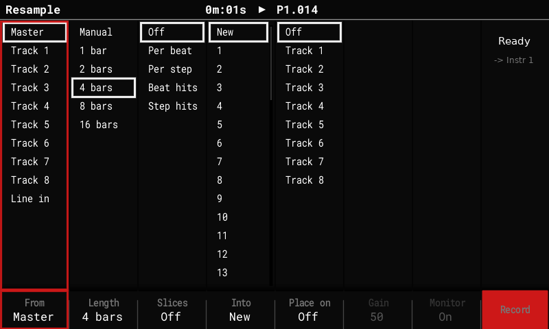
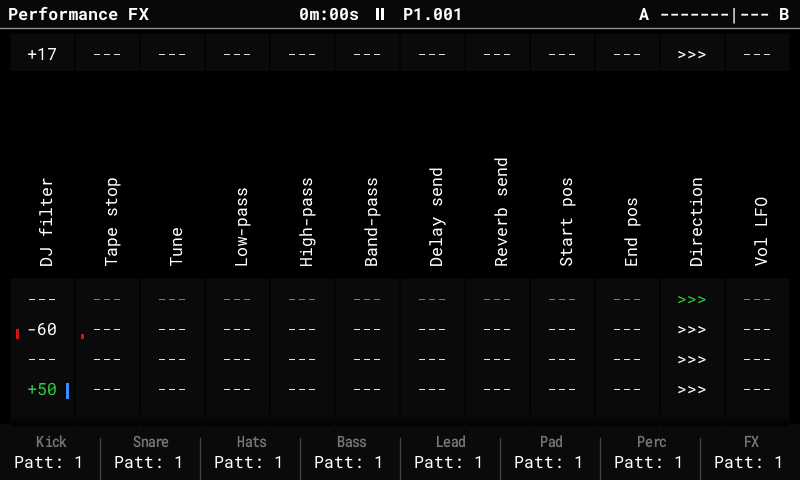
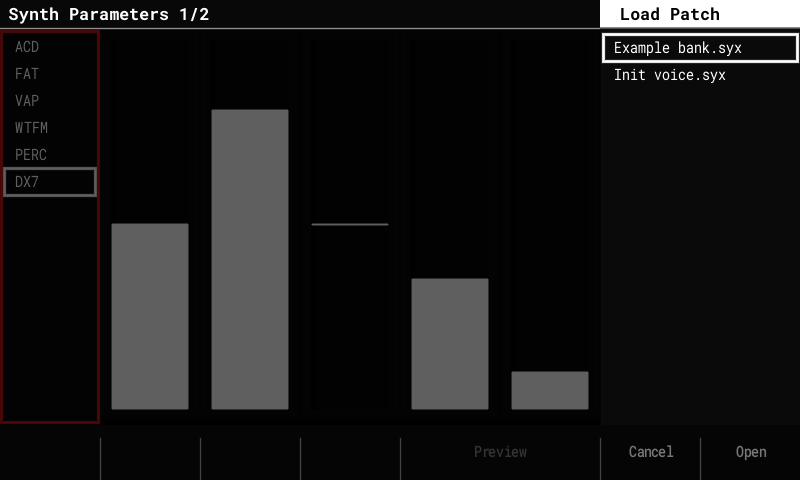
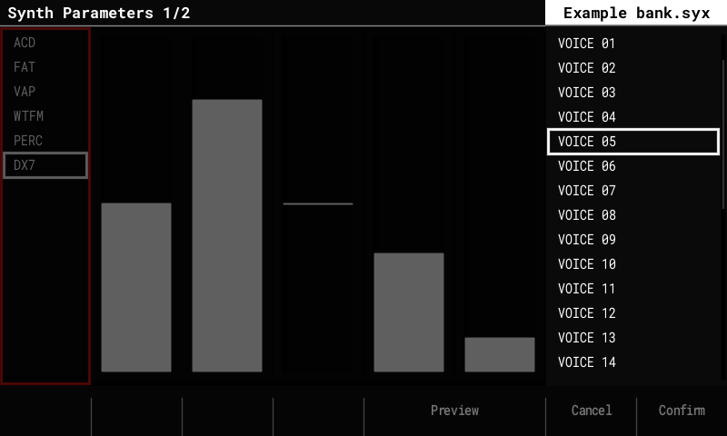
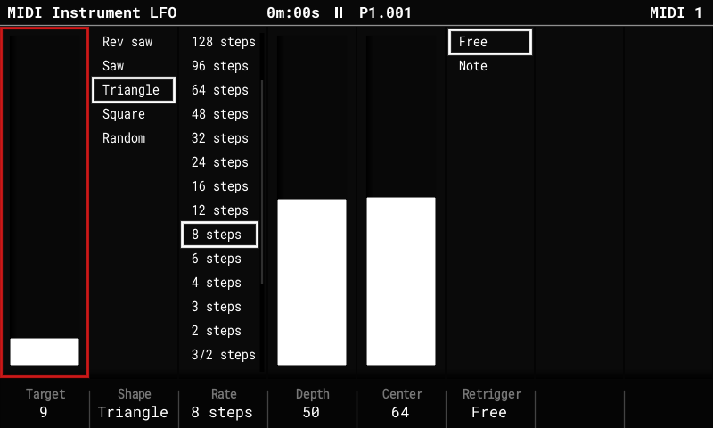
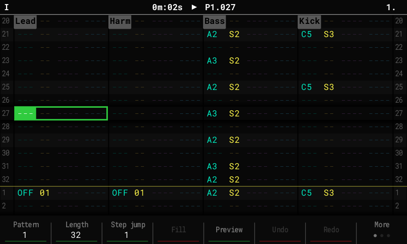

# OpenTracker (syamajala fork)

OpenTracker is an open-source, clean-room firmware for the **original Polyend Tracker**,
written from behavioural specifications. It contains no Polyend code, fonts, icons or
graphics, and is not affiliated with or endorsed by Polyend.

This is a fork of [sandlbn/polyend-tracker-re](https://github.com/sandlbn/polyend-tracker-re).
It follows upstream's 2.x line (currently 2.1.2) and adds the features below. Projects stay
compatible: everything the fork adds is stored in extra files next to `project.mt`, so stock
firmware, upstream OpenTracker and the Tracker Mini still open them (see each feature for
details).

**Documentation:** [syamajala.github.io/polyend-tracker-re](https://syamajala.github.io/polyend-tracker-re/)
(user guide for each feature, install and troubleshooting, and a developer section).

Screenshots are from the desktop simulator, which runs the same code as the firmware.

## What this fork adds

| Live resampling | Performance scenes and master FX |
|---|---|
|  |  |
| **DX7 synth: Load Patch with .syx banks** | **DX7 synth: a bank's voices** |
|  |  |
| **MIDI instrument LFO** | **Pattern** |
|  |  |

### DX7 FM synth
- A **6-operator FM engine that plays Yamaha DX7 voices**, as a sixth synth model next to
  ACD, FAT, VAP, WTFM and PERC. Pick **DX7** in a synth slot's Model list.
- **Load Patch** lists the `.syx` files in `Patches/DX7/`:
  - 32-voice banks come first and open like folders. Pick a voice, Preview it, Confirm;
    **Left** goes back to the folder.
  - Single-voice `.syx` files sit with the patches and preview and load directly.
  - A loaded voice is named after the voice. **Save** writes it as a normal `.patch` file
    (the voice is stored inside it).
- The sound core is a port of Google's Music Synthesizer for Android (msfa, Apache 2.0),
  checked against Dexed. Our additions: amplitude modulation, the feedback loops of
  algorithms 4 and 6, key sync.
- **Edit Patch** has controls that work on top of any loaded voice, without an operator
  editor:
  - **Voice:** Volume, and **Mono** for polyphony 1 slots: **Retrigger** (default; every
    note restarts like a new voice) or **Legato** (a note that overlaps the held one only
    moves the pitch).
  - **Tone:** **Brightness** (modulator levels, ±12 dB), **Feedback** (±7 on the voice's
    own), **Attack** and **Release** (envelope rates, + = slower / longer), **LFO Depth**
    (0–200 % of the voice's vibrato and tremolo, up to the DX7's maximum) and **Detune**
    (spreads the operators up to ±7 cents).
  - A DX7 patch's **macros M1–M6** come aimed at the six Tone controls, named after them,
    so a voice can be shaped from the Synth Macros page or with step FX.
- **Velocity** (the Volume step FX) works as on a DX7: through each operator's velocity
  sensitivity in the voice, so it can change the tone as well as the level. Voices with
  sensitivity 0 ignore it; aim M7 (Velocity) at Volume on those if you want it.
- About 6 % CPU per voice (estimated).
- A Tracker Mini has no DX7 model: it resets a DX7 slot to its default.

### Live resampling
- Record **the master mix, one track (including the synth it plays) or Line in** while the
  sequencer keeps playing, Octatrack-style. The take starts on the next bar and lasts
  1, 2, 4, 8 or 16 bars, or until you stop it.
- **Shift + Sample Recorder** arms, stops or cancels a take from any screen. The **Resample**
  screen opens from the Sample Recorder's "This will stop the pattern" prompt (button
  **Resample**); the pattern keeps playing. Line in has a level meter, Gain and Monitor.
- **Into:** New puts the take into the next free instrument (above every loaded one), in
  stereo, saved with the project. **Instrument N** re-records into N: a take of the same
  length overwrites it in place, without a gap, and keeps N's settings, so a loop can be
  re-sampled take after take. A take of another length is not lost: it goes to a new
  instrument instead. Arming into a slot that holds a sample asks once.
- **Slices:** Off, Per beat, Per step, or **Beat hits / Step hits** (a slice starts only where
  a new hit begins, so empty steps stay empty). Sliced takes play in Beat Slice mode.
- **Place on track N:** the take, or each slice on its own step, is written into a track so
  it plays back in time (undoable).

### Performance mode
- **A bank of 16 scenes with a crossfader** (Octatrack-style). The fader's ends **A** and
  **B** each play a scene from the bank; the encoder or MIDI CC 63 fades between them.
  Filters cross over at the middle, stepped FX switch there.
  - **Performance** (on the Performance screen) opens the **scene bank page**: pick a scene
    with the arrows, encoder or pads, **F1 / F2** put it on A / B, **F3 Edit** opens it on the
    Performance screen, where the pads set its rows (you hear it as you go) and going back
    saves it. **F4** clears a scene, **F8** or Performance returns.
  - Shortcuts while playing: **Shift + Left / Right** store the pad rows into the scene on
    A / B, **Delete + Left / Right** clear it; hold pads to store or clear only those columns.
  - Rows of the scene on A are marked red, on B blue, and the pad LEDs follow the fader.
  - **Left / Right** (outside edit mode) switch the F keys between tracks 1–8 and 9–16
    (stock 2.x used the Performance key).
- **Master insert FX**, played like any other Performance column:
  - **DJ filter:** one filter on the whole mix; below 0 a low-pass sweeping down, above 0 a
    high-pass sweeping up.
  - **Tape stop:** hold its pad and the whole mix slows to a stop over 1 or 2 steps, beats
    or bars; release and it spins back up.
- In edit mode, a tapped row's value can be changed with the encoder without holding the pad.
- The scene bank and the master FX types are stored in `perf_scenes.bin` next to `project.mt`;
  stock firmware sees those slots as empty.

### Song mode
- **Repeat counts:** a **Count** column next to the Song list's patterns plays a slot's
  pattern 1 to 16 times before the song moves on, so a section no longer needs duplicate
  slots. Set it in edit mode (Right from the list, then the encoder; Delete resets it to 1).
  While playing, the playing slot shows its pass, for example `2/4`.
- Add Slot copies the count; Loop Pattern / Continue Song work as before (Continue leaves
  the slot at the end of the current pass).
- **Song + Right** jumps from the track grid straight to the Pattern list; **Song + Left**
  goes back into the grid (edit mode). Shift + Left / Right still sizes the grid selection.
- **Scenes per slot:** a **Scene** column after Count puts a Performance scene from the
  bank on the crossfader's A end as the slot starts, with the fader at A. Edit mode, Right
  to the column: the encoder picks the scene (`-` keeps what plays), Shift + encoder a
  second scene for B (`3>5`). Delete resets it to `-`.
- **Ramps:** a slot with a scene on B sweeps the fader from A to B. The **Ramp** column sets
  when: `Slot` (across every pass), `Each` (across each pass, back to A as the next starts),
  `First` (the first pass, then B), `Last` / `L2` ... `L15` (the last N passes; the choices follow
  the slot's Count) or the slot's last 1-128 steps (Shift + encoder moves 16). Moving the fader yourself takes over until the
  next slot. With four columns the Song list no longer shows pattern names.
- A slot's scene plays on any screen, not only on the Performance screen. It stops at Stop,
  or when the song reaches a `-` slot; on the Performance screen a `-` slot keeps what plays.
  Exports still render without Performance FX.
- Counts, scenes and ramps are stored in `song.bin` next to `project.mt`; stock firmware
  plays every slot once, without scenes.

### MIDI instrument LFO
- One tempo-locked LFO per MIDI instrument, on a new **MIDI Instrument LFO** page (the Instr
  Params key toggles it with the MIDI parameters page).
- Target: a CC (0-127), pitch bend or channel pressure. Shape, Rate (128 steps down to
  1/8 step), Depth, Center, and Retrigger (Free, or restart on each Note).
- LFO messages use at most half of a DIN MIDI port's bandwidth, so notes are never delayed.
- Stored in `midi_lfo.bin` next to `project.mt`.

### Note names
- **Config > General > Note names: Sharps / Flats / Auto.** Auto spells the project's scale
  correctly, modes included (C Mixolydian shows Bb, not A#). Display only.

### Remote control and on-device testing
- **Config > USB > Remote control** (Off after every power-on):
  - **Panel mode:** a Tracker connected over USB becomes the simulator's front panel.
  - **Drive mode:** `tools/tracker_remote.py` runs scripts on the Tracker: button presses,
    status and CPU checks, screenshots and the text on screen. The simulator can mirror the
    Tracker's screen live (`--mirror`).
- **Telemetry** on the USB serial log: CPU per block, the stack high-water mark, I2S input
  health, and per-take resample diagnostics.

### Build and memory
- **Games are off by default** in this fork's builds (`make OT_GAMES=1` builds them); this
  frees 5.8 KB of SRAM and ~49 KB of flash for the features above.
- The UI screens live in SDRAM instead of the SRAM heap, and the stack reserve is 75 KiB
  (measured peak use: 18 KB).
- **CI** builds and tests every push and pull request; tagged versions are released
  automatically (see Install).

## Upstream 2.x features

Upstream's photos (2.0.1, on an original Tracker):

| Pattern | Config: USB Storage |
|---|---|
|  |  |
| **Sample Recorder** | **Synth Parameters: Load Patch** |
|  |  |

2.0 brings the newer Tracker features to the original hardware: 16 tracks, synth
engines, stereo samples, Mini-compatible project files and USB Storage mode. These notes cover
the whole 2.x line.

### New in 2.0

#### Tracker Mini project compatibility
- Projects are saved in the **Tracker 2.2.1 format**: 16-track patterns, the three
  synth slots, track names and mutes for tracks 13–16.
- **Synth patches** use the Mini's `.patch` files. They are stored with the project and in a
  library at `Patches/<ENGINE>/`. All 299 Mini factory patches load and save back unchanged.
- Older original-Tracker projects open as they are, with tracks 13–16 empty.

#### 16 tracks
- Tracks 13–16 work like MIDI tracks 9–12: notes, MIDI channels, CC A–F, pitch bend,
  velocity, mute and solo. Performance Play mode, Pattern length and Step repeater act on them
  too (no voice FX, levels or per-track patterns, as on the Mini).
- Pattern pages through all 16 tracks. Song shows a scrolling 12-track window.
- Fill, copy and paste work across all 16 tracks.

#### Synth engines (instruments S1–S3)
- **Three synth slots**, played from any track as instruments S1–S3.
- Engines, our own sound design following the Mini's parameter sets:
  - **ACD**: acid bass and lead, with a 24 dB and a ladder-style filter, and glide;
  - **VAP**: virtual-analog poly, with morphing oscillators, hard sync, 15 filter types and a
    6-slot modulation matrix;
  - **PERC**: drum kit with kick, snare, hats, cymbal, perc and tom.
- **FAT** (unison supersaw) has an engine since 2.1. **WTFM** patches load and save
  unchanged, but stay silent and show "not available".
- **Macros:** FX columns A–F drive macros 1–6, and Volume drives macro 7.
- **Voices:** a shared pool of 4 voices by default, adjustable in Config > General > Synth
  voices (1–8).
- **Screens, after the Mini's layout:**
  - Synth Parameters: model, polyphony, gain, pan, sends.
  - Synth Macros.
  - Edit Patch: sections on the pads; Save, Save As, Init.
  - Load Patch popup with Preview.
  - Synth 1–3 level columns with meters on Global Mixer page 3.
- Exports include separate stems `synth_1..3.wav`.

#### Stereo samples
- Stereo WAVs keep both channels on import.
- They play in stereo in one-shot, loop, slice and beat-slice modes. Pan works as balance.

#### Performance and monitoring
- **CPU meter** in the title bar (Config > General > CPU meter: Auto, Always or Off).
- **Voice limiter:** if the audio gets close to its limit, only synth voices are cut; sample
  tracks never are.
- **Faster loading:** project loading does about half the work in our host model (not yet
  timed on the device).
- **Smoother display:** frames go to the screen over DMA without waiting.
- **More code in fast internal RAM:** the hottest audio and synth code runs from it.
- **USB serial diagnostics:** CPU, peak breakdown, display, SD and radio/recorder lines.

#### USB Storage mode (2.0.1)
- **Config > USB > USB Storage: On** shows the SD card on a connected computer as a USB drive,
  as on the Tracker Mini. Copy projects, samples and patches without taking the card out.
- Playback stops and the project is saved first. Keep the power and the USB cable connected
  while files are transferred.
- To finish: eject the drive on the computer, then press **Exit** (or set the row back to
  **Off**). The project reloads from the card. If the computer still uses the drive, Exit
  first reminds you to eject it.
- The setting is always **Off** after power-on.
- About 1 MB/s (full-speed USB; measured 1,033 KB/s on a real Tracker). Tested with Linux
  and macOS; Linux can take a few seconds longer to notice the drive. USB MIDI and the
  serial log keep working.
- If the cable is pulled during a transfer, the Tracker recovers within half a second.
- The drive has a stable serial number, so a computer keeps recognising the same Tracker.
  On Windows, the Tracker may appear once as a new device (new COM/MIDI port).

## Install

1. Download the latest image from this fork's
   [Releases](https://github.com/syamajala/polyend-tracker-re/releases) and copy
   `PolyendTrackerOTv212.ptf` to `/Firmware` on the SD card. Keep the name; the bootloader
   only accepts 24-character names.
2. Go to **Config > Firmware update**, select it and confirm. If the screen stays dark
   after the update, press the power button once.

**Going back:** keep the stock `PolyendTracker_1.9.2.ptf` in `/Firmware`. Install it the
same way, or put its file name into `/Firmware/ot_restore.txt` and power-cycle. Keep only the
image you want, plus stock, in `/Firmware`: the rear reset button installs a random `.ptf`
from that folder.

**Note:** projects saved by 2.x use the Mini's 16-track patterns. Stock firmware for the
original Tracker reads only tracks 1–8 of those patterns (expected from the stock loader's
rules; not yet confirmed on a stock unit).

## Building

- Firmware: `make VERSION=2.1.2` (Arm GNU toolchain) writes `build/PolyendTrackerOTv212.ptf`.
- Host tests: `make host-test`. Performance and memory gate: `make perf-gate`.
- Simulator: `make sim`, then `build/sim/opentracker-sim` (see `sim/README.md`).

## Known limitations

- The synth sound is own design: settings match the Mini, the sound is close but not
  identical.
- WTFM has no engine yet. Wavetable and granular samples play the left channel only.
- Synth notes ignore the per-track Performance columns
  ([#30](https://github.com/syamajala/polyend-tracker-re/issues/30)); the master insert FX
  do include them.
- The synth voice pool defaults to 4 because of the processor's speed.
- USB Storage mode: back up the card before first use; Linux systems without a desktop may need
  `partprobe` or a re-plug to see the card.
- The USB ID is the pid.codes test ID 1209:0001.

## Test songs

`make testsongs` builds nine OT Test songs and seven BLAST GRID synth remixes (Title,
World 1, World 4, Battle, Battle FM, Boss, Final Boss) into `build/testsongs/`. Copy its
`Projects/` and `Samples/` folders to the card.
