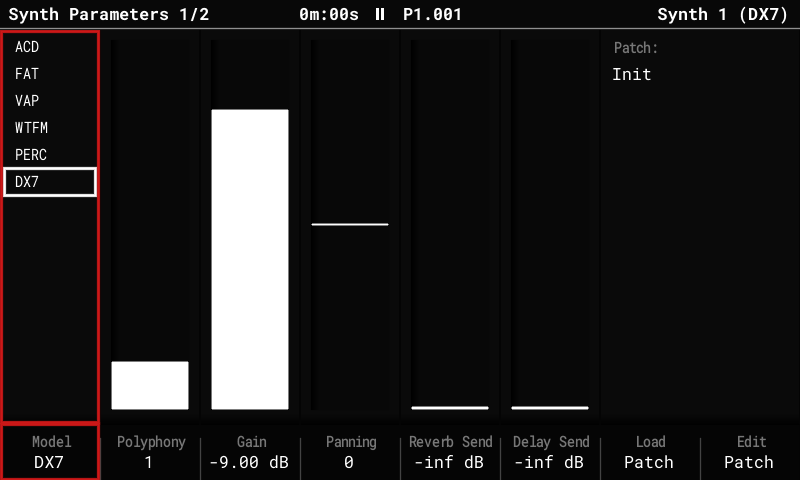
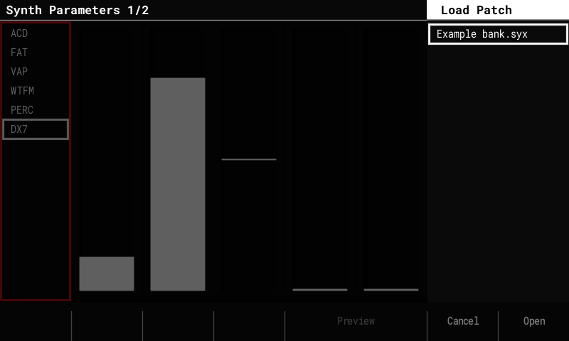
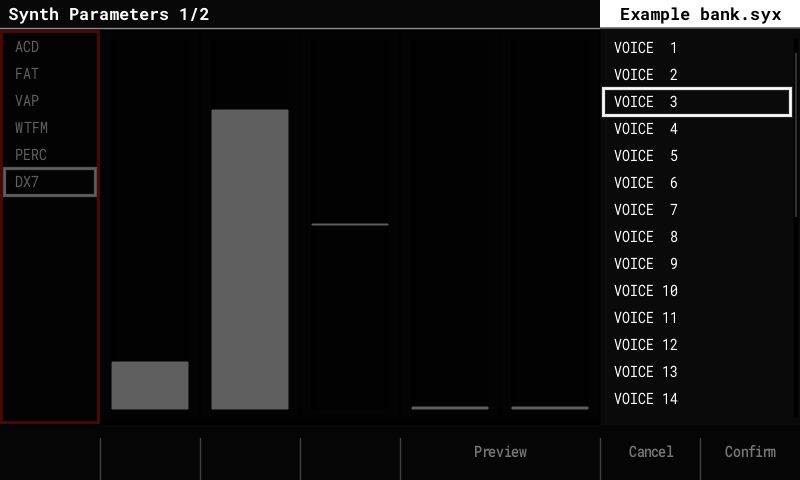
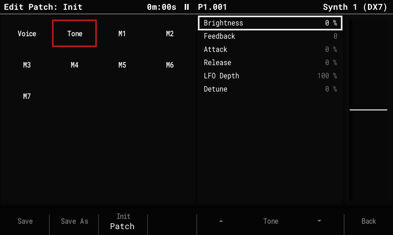
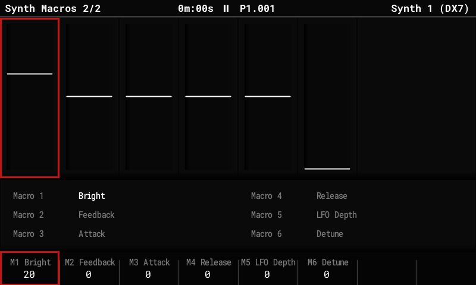

# DX7 synth

A **6-operator FM engine that plays Yamaha DX7 voices**, available as a sixth synth model
next to ACD, FAT, VAP, WTFM and PERC. Thousands of free DX7 voices exist as SysEx
(`.syx`) files; the Tracker plays them directly.

## Use a DX7 voice

1. Put `.syx` files in **`Patches/DX7/`** on the SD card. Both kinds work:
    - **32-voice banks** (4,104 bytes, the usual "bank" files);
    - **single-voice dumps** (163 bytes).
2. Select a synth instrument (S1–S3): hold **Instrument** and turn the encoder.
3. Press **Instrument Params**. On **Synth Parameters**, set **Model** to **DX7**
   (it's the last entry in the list).
4. Press **Load Patch** (F7).

5. Banks come first in the list and open like folders: highlight one and press **Open**
   (F8). Pick a voice, **Preview** (F5, hold) to hear it, **Confirm** (F8) to load it.
   **Left** goes back to the bank list. Single-voice files sit with the patches and
   preview and load directly.

The loaded voice is named after the DX7 voice. **Save** (in Edit Patch) writes it as an
ordinary `.patch` file in `Patches/DX7/`, with the voice stored inside it; the project
keeps it too.

## Shape a voice

There's no operator editor yet, but **Edit Patch** has controls that work **on top of any
loaded voice**, without changing the voice itself:

| Section | Control | What it does |
|---|---|---|
| Voice | **Volume** | The voice's level. |
| Voice | **Mono** | For polyphony 1 slots: **Retrigger** (default) or **Legato**, see below. |
| Tone | **Brightness** | ±100 %: the modulators' levels, ±12 dB. More or fewer harmonics. |
| Tone | **Feedback** | ±7, added to the voice's own feedback (0–7). |
| Tone | **Attack** | ±100 %: every operator's first envelope rate. + = slower. |
| Tone | **Release** | ±100 %: every operator's release rate. + = longer tails. |
| Tone | **LFO Depth** | 0–200 % of the voice's vibrato and tremolo, up to the DX7's maximum. |
| Tone | **Detune** | 0–100 %: spreads the operators up to ±7 cents apart (chorus-like beating). |

Each loaded DX7 voice comes with **macros M1–M6 aimed at the six Tone controls** and
named after them (M1 Bright, M2 Feedback … M6 Detune). So a voice can be shaped from the
**Synth Macros** page (Instrument Params again), or per step with the **macro FX**
(columns A–F), without opening Edit Patch. The macros can still be re-aimed on their
Edit Patch pages.

How much a control changes depends on the voice: Brightness does nothing on a voice
without modulators, and Feedback is only heard when the feedback operator is audible.

## Playing

- DX7 slots play from any track like the other synths: notes, the step FX for pitch
  (Glide, Slide, Tune, Micro-tune), the Volume FX and the macro FX.
- **Polyphony** is set on Synth Parameters. On a **polyphony 1** slot, **Mono** decides
  what a new note does:
    - **Retrigger** (default): every note starts like a new voice, its envelopes from the
      beginning (without a click).
    - **Legato:** a note that overlaps the held one only moves the pitch; the envelopes
      run on, as on a DX7 in mono mode.
- **Velocity** (the Volume step FX on a step with a note) works as on a DX7: through each
  operator's **velocity sensitivity** in the voice. On some voices it changes the level,
  on others mostly the tone (a velocity-sensitive modulator gets brighter with
  velocity). Voices whose operators have sensitivity 0 ignore it. To make one respond in
  level anyway, aim **M7 (Velocity)** at Volume on its Edit Patch page.
    - A Volume FX on a step **without** a note doesn't change a held DX7 note: velocity
      only counts when a note starts.
- **CPU:** about 6 % per voice (estimated). The voice limiter cuts synth voices first if
  the audio gets close to its limit.

## Good to know

- The sound core is a port of Google's Music Synthesizer for Android (msfa, Apache 2.0),
  checked against [Dexed](https://asb2m10.github.io/dexed/) note by note. Our additions:
  amplitude modulation, the feedback loops of algorithms 4 and 6, and key sync.
- For deeper edits, edit the voice in a DX7 editor on a computer (Dexed works) and copy the
  `.syx` file over.
- A Tracker Mini has no DX7 model: it resets a DX7 slot to its default when it opens the
  project.
