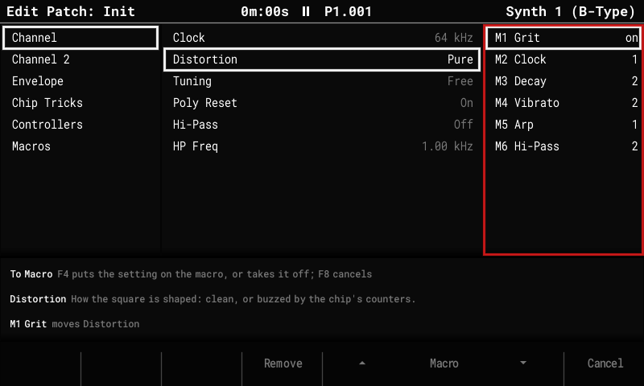
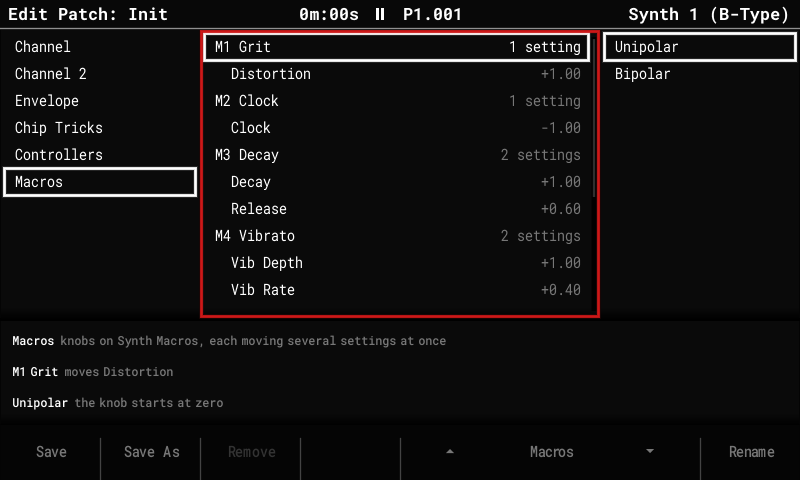

# Edit Patch and synth help

**Edit Patch** (Instrument Params on a synth slot, then **F8**) shows every setting of the
slot's synth. In this fork it's laid out like **Config**, and a help box explains whatever
you're on.

## The layout

Three columns, left to right:

| Column | Shows |
|---|---|
| Sections | the synth's groups of settings (Channel, Envelope …), then **Macros** |
| Settings | the settings of the selected section, with their values |
| Value | the selected setting's value: a list of choices, or a bar for a number |

- **Left / Right** move the red frame from column to column.
- **Up / Down** and the **knob** move inside the framed column: in the value column they
  change the setting. In a list, Down goes down the list; on a bar, Up raises the value.
- **F5 / F7** move to the previous / next setting and **F6** to the next section, wherever
  the frame is.
- **Delete** puts the selected setting back to its Init value.
- **F1 Save**, **F2 Save As**, **F3 Init Patch** and **F8 Back** work as before.
- **F4 To Macro** puts the selected setting on a macro (below).
- **All 48 pads play** the synth while you edit (stock picks the section with the pads).

## Macros

A macro is one knob that moves several settings at once: M1–M6 are the knobs on the
**Synth Macros** page (Instrument Params again) and the pattern's FX columns A–F, M7 follows
the Volume column. With a macro at +1.00 on a setting, turning the knob all the way up moves
that setting across its whole range; −1.00 moves it the other way.

**Put a setting on a macro:** select the setting, press **F4 To Macro**. The value column
lists M1–M6 with how many settings each one moves, and **on** where this setting already is.
Pick one with **Up / Down** or the knob and press **F4** again: **Add** puts the setting on
it at +1.00, **Remove** takes it off. **F8** cancels. A macro without a name of its own takes
the setting's name. A macro moves at most five settings.

**The Macros section**, the last in the list, shows every macro with the settings it
moves:

- On a macro's row: **Unipolar** (the knob goes from 0 up) or **Bipolar** (the middle is
  0) in the value column; **F8 Rename** names it.
- On one of its settings: the amount in the value column, −2.00 to +2.00; **F3 Remove**
  takes the setting off the macro; **Delete** puts the amount back to the Init patch's.

The **Synth Macros** page lists under each bar the settings its macro moves, with **+** or
**−** for the direction, or "not set".

New patches come with their macros already set on some synths: B-Type's Init patch has
Grit (Distortion), Clock (down), Decay (Decay and Release), Vibrato (depth and rate), Arp
(the arp chord) and Hi-Pass (Hi-Pass and HP Freq); DX7's has Bright, Feedback, Attack,
Release, LFO Depth and Detune.

## The help box

Under the columns, three lines:

1. the **section**: what the group is for;
2. the **setting**: what it does;
3. the **choice** you're on, or for a number, what low and high values do.

For example, on B-Type's **Channel > Distortion** with **Poly5**: "Channel: the main voice,
a chip square wave and how buzzy it is", "Distortion: how the square is shaped", "Poly5: a
5-step pattern".

The texts come from the SD card, `Help/Synths/<SYNTH>.md` (in `Modules.zip` on the release
page, next to the card modules; see [Install the modules](../install.md#install-the-modules)).
Without the file the box says which one is missing, and everything else works as usual.

So far **B-Type** has a help file; the other synths follow.

## Writing a help file

Each synth's help is a Markdown file next to its code in the module repository,
`modules/<synth>/help/<SYNTH>.md`. It has two parts:

- a **guide** for these docs (how the synth works, tips), free Markdown;
- **`# Settings`**, the short reference the help box shows: `##` a section, `###` a
  setting, `- Choice: text` for each choice, named exactly as on screen, with one short
  paragraph under each heading.

Only the reference goes on the card. `make host-test` checks it against the synth: every
section, setting and choice needs a line, and each line has to fit the box. The format is
in `src/core/modules/synth_help.h`.
