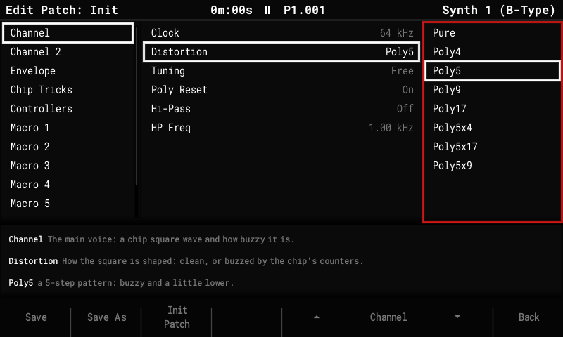

# Edit Patch and synth help

**Edit Patch** (Instrument Params on a synth slot, then **F8**) shows every setting of the
slot's synth. In this fork it's laid out like **Config**, and a help box explains whatever
you're on.

## The layout

Three columns, left to right:

| Column | Shows |
|---|---|
| Sections | the synth's groups of settings (Channel, Envelope, Macro 1 …) |
| Settings | the settings of the selected section, with their values |
| Value | the selected setting's value: a list of choices, or a bar for a number |

- **Left / Right** move the red frame from column to column.
- **Up / Down** and the **knob** move inside the framed column: in the value column they
  change the setting. In a list, Down goes down the list; on a bar, Up raises the value.
- **F5 / F7** move to the previous / next setting and **F6** to the next section, wherever
  the frame is.
- **Delete** puts the selected setting back to its Init value.
- **F1 Save**, **F2 Save As**, **F3 Init Patch** and **F8 Back** work as before.
- **All 48 pads play** the synth while you edit (stock picks the section with the pads).

## The help box

Under the columns, three lines:

1. the **section**: what the group is for;
2. the **setting**: what it does;
3. the **choice** you're on, or for a number, what low and high values do.

For example, on B-Type's **Channel > Distortion** with **Poly5**: "Channel: the main voice,
a chip square wave and how buzzy it is", "Distortion: how the square is shaped", "Poly5: a
5-step pattern".

The texts come from the SD card, `Help/Synths/<SYNTH>.md` (in `Modules.zip` on the release
page, next to the card modules; see [Install the modules](../install.md#install-the-modules)).
Without the file the box says which one is missing, and everything else works as usual.

So far **B-Type** has a help file; the other synths follow.

## Writing a help file

Each synth's help is a Markdown file next to its code in the module repository,
`modules/<synth>/help/<SYNTH>.md`. It has two parts:

- a **guide** for these docs (how the synth works, tips), free Markdown;
- **`# Settings`**, the short reference the help box shows: `##` a section, `###` a
  setting, `- Choice: text` for each choice, named exactly as on screen, with one short
  paragraph under each heading.

Only the reference goes on the card. `make host-test` checks it against the synth: every
section, setting and choice needs a line, and each line has to fit the box. The format is
in `src/core/modules/synth_help.h`.
