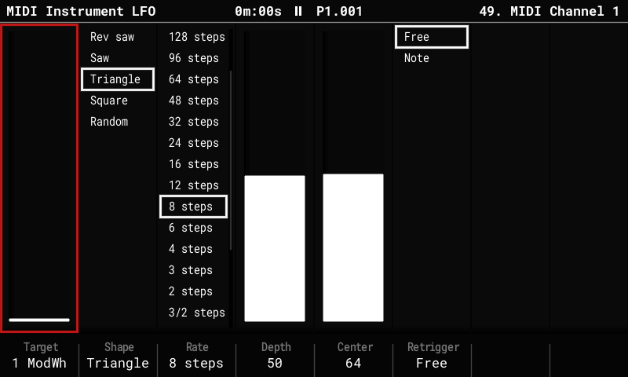

# MIDI instrument LFO

Each MIDI instrument (MIDI 1–16) gets one **tempo-locked LFO**, sent alongside its notes.

## Set it up

1. Select a MIDI instrument: hold **Instrument** and turn the encoder.
2. Press **Instrument Params**, then **Instrument Params** again: the key steps
   through the MIDI parameters page, the **MIDI Instrument LFO** page and the
   [MIDI Instrument Preset](midi-presets.md) page.

| Setting (key) | Choices |
|---|---|
| **Target** (F1) | Off, the instrument's CC slots A–F, pitch bend, channel pressure, then every other CC (0–127). A CC named in the [preset](midi-presets.md) shows its name. Turning the encoder only picks the target; the LFO moves to it once the encoder rests, so the CCs passed on the way are left alone. |
| **Shape** (F2) | Rev saw, Saw, Triangle, Square, Random. |
| **Rate** (F3) | From 128 steps per cycle down to 1/8 step, locked to the tempo. |
| **Depth** (F4) | How far it moves around Center. |
| **Center** (F5) | The value it moves around. |
| **Retrigger** (F6) | **Free** (follows the song position) or **Note** (restarts with each note). |

## Good to know

- LFO messages use at most **half of a DIN MIDI port's bandwidth**, so notes are never
  delayed by them.
- The LFO runs while the sequencer plays. At Stop, its target is left at **Center**, and so
  is a target you switch away from (or turn Off) while playing.
- **Depth** is a percentage of half the target's range around Center.
- A step FX on the same target (a CC FX on the LFO's CC, pitch bend, or pressure) moves
  the LFO's **Center**, so the pattern can shift the wobble around.
- Stored in `midi_lfo.bin` next to `project.mt`; other firmware ignores it.
