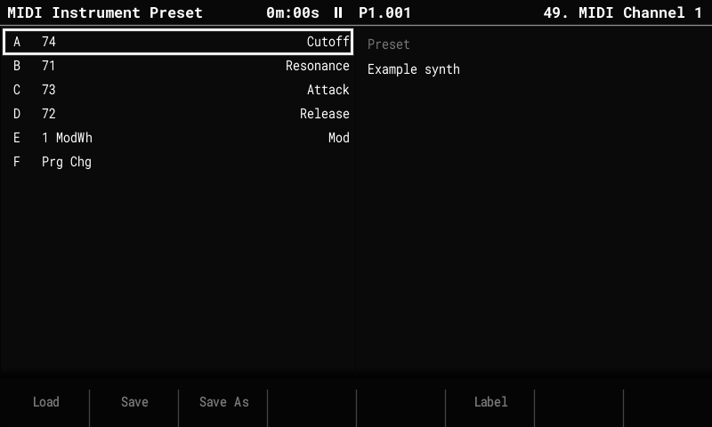

# MIDI presets

A **MIDI preset** describes a synth: the names of its CCs (its **CC chart**, "74 Cutoff"),
which CCs the six slots A–F use, velocity, offset and the [MIDI LFO](midi-lfo.md). Save it
once, then load it into any MIDI instrument in any project.

The CC names show wherever a CC appears: as the slot name on the MIDI parameters page
("Cutoff" instead of "CC A"), in the CC A–F choice lists ("74 Cutoff") and as the LFO
target. Step FX in the pattern still read CC A–F, as on the original firmware.

A preset describes the synth, not a sound or a channel:

- **No channel.** It loads into whichever MIDI instrument is open, and that instrument's
  channel stays. A synth that listens on several channels (an Elektron Model:Cycles, one
  channel per track) uses one preset on each of them. Instruments that load the same
  preset share its CC chart, so a name changed on one shows on all of them.
- **No program change.** To switch the synth's sound in a song, set a CC slot to
  **Prg Chg** and put that FX on a step.



## The Preset page

1. Select a MIDI instrument: hold **Instrument** and turn the encoder.
2. Press **Instrument Params** until the title reads **MIDI Instrument Preset** (it steps
   through Parameters, LFO and Preset).

The left list is the CC chart: CC 0–127 with their names, and the letters of the slots
that use each CC. It opens on slot A's CC. The right side shows the preset this
instrument came from or was saved as, and the six slots.

| Key | Action |
|---|---|
| Encoder, **Up / Down** | Select a CC (hold **Shift** to move faster). |
| **F6 Name** | Name the selected CC (up to 9 characters). |
| **Delete** | Clear the selected CC's name. |
| **F1 Load** | List the presets on the card; the encoder or **Up / Down** move, **F8 Load** loads into this instrument, **F7 Cancel** closes the list. |
| **F2 Save** | Save under the preset's name (no name yet: as Save As). |
| **F3 Save As** | Save under a new name (asks before replacing a preset). |

Which CC a slot uses is set on the MIDI parameters page, as before. The names and the
preset name are saved with the project (`midi_names.bin`, next to `project.mt`), so
`project.mt` stays readable by the original firmware. A project holds up to 400 CC names
in all (about eight fully named synths).

## Presets that come with OpenTracker

Each release has a `MidiPresets.zip`: unzip it to the root of the card. It holds:

| Preset | Channels | Slots A–F |
|---|---|---|
| **Model Cycles** | one per track (load it on each) | Color, Shape, Sweep, Contour, Decay, Delay send |
| **Syntakt** | audio tracks 1–12 (Syn A–H = the machine's parameters) | Cutoff, Reso, Filter env, Amp decay, Delay send, Reverb send |
| **Syntakt FX** | the FX track | Filter freq, Filter reso, Drive, Delay mix, Reverb mix, Delay time |
| **volca fm2** | its channel (needs MIDI RX ShortMessage on) | Mod decay, Carrier decay, Algorithm, LFO rate, LFO pitch, Reverb |
| **SP-404MKII** | 1–4 = BUS 1–4, 5 = INPUT FX | Ctrl 1–4, FX on, FX select |
| **S-1** | its channel | Cutoff, Reso, Filter env, Decay, Delay, Reverb |

Each names every CC in the synth's MIDI chart. They are in `midi_presets/` in the source;
more synths are welcome.

## The preset file

Presets are text files in `MidiPresets/` on the card, named `<name>.txt`, so they can be
written or edited on a computer. For example, a Roland S-1:

```
# OpenTracker MIDI preset
velocity = 127
offset = 0
slot A = 74
slot B = 71
slot C = 24
slot D = 75
slot E = 92
slot F = 91
cc 3 = LFO Rate
cc 24 = Filt Env
cc 71 = Reso
cc 74 = Cutoff
cc 75 = Decay
cc 91 = Reverb
cc 92 = Delay
lfo target = slot A
lfo depth = 30
```

- `slot A` … `slot F`: a CC number (0–127), `PC` (program change), `AT` (channel
  pressure) or `PAT` (poly aftertouch).
- `cc n = name`: the name of CC n (0–127), up to 9 characters.
- `lfo target`: `off`, `slot A` … `slot F`, `PB` (pitch bend) or `AT`. `CC n` also
  works: it picks the slot set to CC n.
- `lfo shape`: 0 Rev saw, 1 Saw, 2 Triangle, 3 Square, 4 Random.
- `lfo rate`: 0 (128 steps per cycle) to 22 (1/8 step), as listed on the LFO page.
- `lfo depth` 0–64 (the swing either side of the center), `lfo center` 0–127,
  `lfo retrigger` 0 Free or 1 Note.

Lines starting with `#` are comments, keys ignore case, and a missing or unknown line keeps
the default, so a preset can be as short as one `cc` line.
