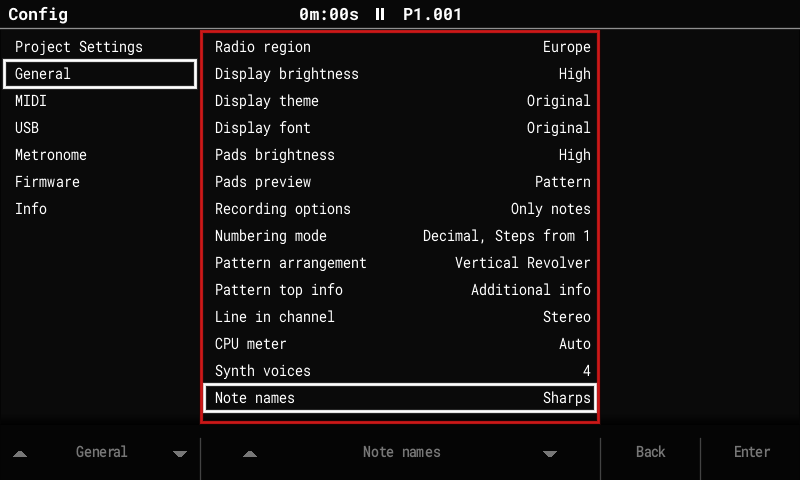
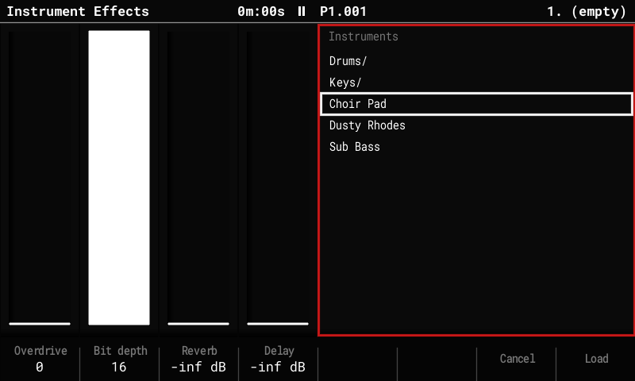

# More features

## Note names

**Config > General > Note names: Sharps / Flats / Auto.** Auto spells notes the way the
project's scale does, modes included: C Mixolydian shows B♭, not A♯. Display only.



## Piano pads

**Config > General > Pad layout: Stock / Piano.** Piano turns the pads into two keyboards
that light up as ones, laid out as on grid controllers: each pair of rows is a keyboard,
with the white keys along the lower row and the black keys in the row above, each black
key over the white key to its right.

```
·  C# D# ·  F# G# A# ·  C# D# ·  F#     upper keyboard
C  D  E  F  G  A  B  C  D  E  F  G
·  C# D# ·  F# G# A# ·  C# D# ·  F#     lower keyboard
C  D  E  F  G  A  B  C  D  E  F  G
```

- Each keyboard spans an octave and a fifth; the upper one is the same keyboard an octave
  higher.
- The pads marked `·` (over C and F, where a piano has no black key) are dark and play
  nothing.
- The bottom-left C is the C of the project's root note octave. To play higher or lower,
  change the root note.
- The lights show the keyboard. With a scale picked, the scale's keys light at one level,
  black or white, the root brighter; keys outside the scale stay playable but are barely
  lit, so the scale shows on the keyboard. In Chromatic the lights draw a piano: white keys
  lit, black keys a little dimmer, the root brightest.
- It works wherever the pads play notes: the pattern editor's Note column, Sample
  Playback, the instrument pages, the synth browser, the Sample Editor and the recorder.
  In the pattern editor the step's note (and, with Pads preview, the notes on the current
  line) lights at full brightness.
- Pads that do something else keep their own lights: the Instr and FX columns,
  Performance, the synth edit page, and Beat Slice instruments (one pad per slice).
- Stock is the default and keeps the original layout. The setting is global, not saved
  with the project.

### Chord hints

With a scale picked (Config > Project Settings), hold a key on the piano pads and the
notes of its chord light up. In A minor, hold E: on the upper keyboard E, G and B light
(Em, the chord on E in the key), on the lower keyboard E, G# and B (E major, its
alternate). Press the lit keys to play the chord. The screen shows
`Em  v: E G B  /  E  V: E G# B` while you hold it.

- The upper keyboard shows the chord built from the scale's own notes (every other note
  of the scale: root, 3rd, 5th), with its number in the key (`v`).
- The lower keyboard shows the alternate major / minor chord on the same root: the 3rd
  moved a semitone, so a minor chord becomes major and the other way round. Some of these
  are common outside notes (E major in A minor is the V chord of harmonic minor), others
  just a colour to try. Diminished and augmented chords have none.
- With **Note names** on Auto the notes are spelled from the key, one letter per note of
  the scale: in F# major the chord on E# is `E#dim: E# G# B`, not F. With Sharps or Flats
  they follow that setting.
- In a mode the hints show the mode's own chords (in D Dorian, G is major: `G  IV`).
  Song mode progressions play modes as their parallel major or minor key, so a chord from
  a progression can differ from the hint (`i VI` in D Dorian is Dm Bb).
- No hints in Chromatic or in scales of fewer than 5 notes, or where the pads do something
  else (Performance).

## Chord entry

In the pattern editor's edit mode (stopped), pads pressed while another note pad is still
held make a chord: the first note goes on the cursor's step and the cursor moves on as
usual; each further note goes on the same step, one track to the right. Hold the chord's
pads together, release them, and play the next chord.

- With a selection over several tracks, the chord fills the selected tracks on the
  selection's first step instead, and the cursor stays.
- One Undo removes the whole chord.
- A track that can't play the current instrument (a MIDI track for a sample instrument)
  ends the chord there.
- Live recording (Rec while playing) already spreads a chord over the next free tracks.

## Slices to pattern

Chop a break, then press one key to get a pattern that plays it. On the Sample Playback screen
(Slice or Beat Slice mode), open the **More** page (F6):

| Key | Does |
|---|---|
| **Steps** (F4) | How many steps the sample lasts. The guess is its length at the song tempo, rounded to 1, 2, 4 or 8 bars; turn the encoder if it guessed wrong (a 2-bar break at 92 BPM in a 140 BPM song reads as 4 bars). |
| **To Pattern** (F5) | Writes the slices on the pattern's current track (the one the cursor was on). |

- Slice i goes on the step nearest where it starts, as note 24 + i, with the steps in
  between empty, so each slice plays on to the next one. The trigs repeat every Steps
  steps to the end of the track.
- The track is cleared first; it asks when the track had steps. Undo in the pattern
  editor brings them back.
- A Slice instrument turns Beat Slice, so each note plays its own slice.
- At another song tempo the slices play at their own speed and pitch (as REX loops do):
  a faster song cuts each slice short at the next trig, a slower one leaves a short gap
  after it. The pattern keeps its
  length; a sample longer than the track is placed once, cut at the track's end.
- Slice first: Auto (F1) for drum breaks, Evenly (F2) for loops in time.

## Instrument library

Keep a sample instrument you've set up (its sample, play mode, slices, envelopes, filter,
effects…) and use it again in any project. On the **Instrument Effects** page (Instrument
Params, then **More**):

- **Save (F7)** opens the keyboard with the instrument's name; **Save** writes it to
  `Instruments/<name>.pti` on the card (into the folder you last opened in Load). An
  existing name asks before replacing it.
- **Load (F6)** lists `Instruments/`: folders first, then instruments. **F8** opens a folder
  or loads the instrument into the current slot (replacing it); **Left** goes up a folder
  (at `Instruments/` it closes the list); **F7** cancels. Folders can be nested as deep
  as you like.



- The files are stock `.pti` instruments: the Sample Loader lists them too, and stock
  firmware loads them.
- A long instrument streamed from the card is copied in full first, so Save can take a
  moment.
- An instrument that doesn't fit in the free sample memory isn't loaded ("Not enough sample
  memory"); the slot keeps what it had.
- A [multisample](multisample.md) instrument saves as a **Slice** instrument (one zone per
  slice, as stock firmware sees it): the zones' root notes and the Multi play mode are kept
  with the project, not in the `.pti`.

## Memory

**Config > Memory** shows what fills the Tracker's memory, for when something won't load.
For example, with DX7 on a synth slot, turning on a third card effect can fail with "Card
memory full". The page shows DX7 taking 18 KB of the 32 KB, so you know to turn off an
effect or switch the slot to a built-in synth.

- **Card modules**: the card synths and effects that are loaded (DX7, Echo …), what uses
  them (`synth, slot 2`, `effect`) and their size. Ones that are wanted but not in are
  listed too, with why: **loads at Stop**, **no room** (red), **didn't load**.
- **Sample memory**: the samples, plus what is borrowed from it: card effects' buffers
  (Echo's 48 KB line) and the space held back while resampling or during a tape stop.
- The bar turns red at 90 %. The page is read-only.

When a card module doesn't fit, the notice names the biggest one loaded, e.g. "Echo: Card
memory full (DX7 18.3 KB)", and the FX bank shows how much card memory is used. In the
simulator the card modules are built in, so the page lists only the sample memory.

## The 2.x features (from upstream)

The 2.x line brings the newer Tracker features to the original hardware. In short:

### Tracker Mini project compatibility

- Projects are saved in the **Tracker 2.2.1 format**: 16-track patterns, the three synth
  slots, track names and mutes for tracks 13–16.
- **Synth patches** use the Mini's `.patch` files, stored with the project and in a
  library at `Patches/<ENGINE>/`. All 299 Mini factory patches load and save back
  unchanged.

### 16 tracks

- Tracks 13–16 work like MIDI tracks 9–12: notes, MIDI channels, CC A–F, pitch bend,
  velocity, mute and solo. Performance Play mode, Pattern length and Step repeater act on
  them too.
- Pattern pages through all 16 tracks; Song shows a scrolling 12-track window. Fill, copy
  and paste work across all 16.

### Synth engines (instruments S1–S3)

- **Three synth slots**, played from any track as instruments S1–S3.
- Engines: **ACD** (acid bass and lead, 24 dB and ladder-style filters, glide), **VAP**
  (virtual-analog poly, morphing oscillators, hard sync, 15 filter types, a 6-slot
  modulation matrix), **PERC** (a drum kit), **FAT** (unison supersaw), **WTFM**
  (two-operator wavetable FM), and in this fork **[DX7](dx7.md)** (from the card).
- **Macros:** FX columns A–F drive macros 1–6, and Volume drives macro 7.
- **Voices:** a shared pool of 4 by default, adjustable in **Config > General > Synth
  voices** (1–8). If the audio gets close to its limit, only synth voices are cut; sample
  tracks never are.
- Screens after the Mini's layout: Synth Parameters, Synth Macros, Edit Patch (sections on
  the pads; Save, Save As, Init), the Load Patch popup with Preview, and the synth level
  columns on Global Mixer page 3.
- Exports include separate stems `synth_1..3.wav`.

### Export sample rate

**Config > General > Export sample rate: 44.1 kHz (default) or 44117 Hz.** The Tracker's
audio runs at 44,117 Hz. At 44.1 kHz, exported songs, patterns, stems and renders are
converted to a standard 44,100 Hz WAV, so they play in time in any DAW. 44117 Hz writes
the Tracker's own rate, as the original firmware does.

### Radio stereo

**Config > General > Radio stereo: Off (default) or On.** On records the built-in radio in
stereo, and the Sample Recorder's source list shows `Radio ST`. Off keeps it mono, as the
original firmware does: mono is cleaner on weak stations and doubles the recording time.

### Stereo samples

Stereo WAVs keep both channels and play in stereo in one-shot, loop, slice and beat-slice
modes; pan works as balance.

### CPU meter

**Config > General > CPU meter: Auto, Always or Off** shows the audio load in the title
bar.

### USB Storage mode

**Config > USB > USB Storage: On** shows the SD card on a connected computer as a USB drive,
as on the Tracker Mini, so projects, samples and patches can be copied without taking the
card out.

- Playback stops and the project is saved first. Keep the power and the cable connected
  while files are copied.
- To finish, eject the drive on the computer, then press **Exit** (or set the row back to
  Off). The project reloads from the card.
- It's always Off after power-on. About 1 MB/s (full-speed USB). USB MIDI and the serial
  log keep working.
- On Windows the Tracker may appear once as a new device (new COM/MIDI port).
