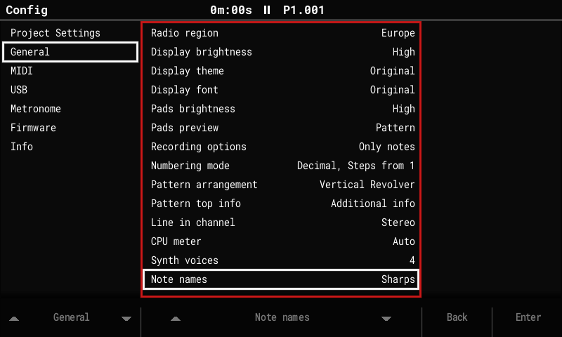

# More features

## Note names

**Config > General > Note names: Sharps / Flats / Auto.** Auto spells notes the way the
project's scale does, modes included: C Mixolydian shows B♭, not A♯. Display only.



## Piano pads

**Config > General > Pad layout: Stock / Piano.** Piano turns the pads into a two-octave
keyboard that lights up as one. Each column is a semitone, C on the left to B on the right,
and each pair of rows is an octave: white keys in the lower row, black keys in the row above.

```
·  C# ·  D# ·  ·  F# ·  G# ·  A# ·     upper octave
C  ·  D  ·  E  F  ·  G  ·  A  ·  B
·  C# ·  D# ·  ·  F# ·  G# ·  A# ·     lower octave
C  ·  D  ·  E  F  ·  G  ·  A  ·  B
```

- The pads marked `·` are dark and play nothing.
- The bottom-left C is the C of the project's root note octave. To play higher or lower,
  change the root note.
- The lights show the keyboard: the scale's root brightest, white keys lit, black keys a
  little dimmer. Keys outside the project's scale stay playable but are barely lit, so the
  scale shows on the keyboard.
- It works wherever the pads play notes: the pattern editor's Note column, Sample
  Playback, the instrument pages, the synth browser, the Sample Editor and the recorder.
  In the pattern editor the step's note (and, with Pads preview, the notes on the current
  line) lights at full brightness.
- Pads that do something else keep their own lights: the Instr and FX columns,
  Performance, the synth edit page, and Beat Slice instruments (one pad per slice).
- Stock is the default and keeps the original layout. The setting is global, not saved
  with the project.

## The 2.x features (from upstream)

The 2.x line brings the newer Tracker features to the original hardware. In short:

### Tracker Mini project compatibility

- Projects are saved in the **Tracker 2.2.1 format**: 16-track patterns, the three synth
  slots, track names and mutes for tracks 13–16.
- **Synth patches** use the Mini's `.patch` files, stored with the project and in a
  library at `Patches/<ENGINE>/`. All 299 Mini factory patches load and save back
  unchanged.

### 16 tracks

- Tracks 13–16 work like MIDI tracks 9–12: notes, MIDI channels, CC A–F, pitch bend,
  velocity, mute and solo. Performance Play mode, Pattern length and Step repeater act on
  them too.
- Pattern pages through all 16 tracks; Song shows a scrolling 12-track window. Fill, copy
  and paste work across all 16.

### Synth engines (instruments S1–S3)

- **Three synth slots**, played from any track as instruments S1–S3.
- Engines: **ACD** (acid bass and lead, 24 dB and ladder-style filters, glide), **VAP**
  (virtual-analog poly, morphing oscillators, hard sync, 15 filter types, a 6-slot
  modulation matrix), **PERC** (a drum kit), **FAT** (unison supersaw), and in this fork
  **[DX7](dx7.md)**. **WTFM** patches load and save but stay silent ("not available").
- **Macros:** FX columns A–F drive macros 1–6, and Volume drives macro 7.
- **Voices:** a shared pool of 4 by default, adjustable in **Config > General > Synth
  voices** (1–8). If the audio gets close to its limit, only synth voices are cut; sample
  tracks never are.
- Screens after the Mini's layout: Synth Parameters, Synth Macros, Edit Patch (sections on
  the pads; Save, Save As, Init), the Load Patch popup with Preview, and the synth level
  columns on Global Mixer page 3.
- Exports include separate stems `synth_1..3.wav`.

### Export sample rate

**Config > General > Export sample rate: 44.1 kHz (default) or 44117 Hz.** The Tracker's
audio runs at 44,117 Hz. At 44.1 kHz, exported songs, patterns, stems and renders are
converted to a standard 44,100 Hz WAV, so they play in time in any DAW. 44117 Hz writes
the Tracker's own rate, as the original firmware does.

### Stereo samples

Stereo WAVs keep both channels and play in stereo in one-shot, loop, slice and beat-slice
modes; pan works as balance.

### CPU meter

**Config > General > CPU meter: Auto, Always or Off** shows the audio load in the title
bar.

### USB Storage mode

**Config > USB > USB Storage: On** shows the SD card on a connected computer as a USB drive,
as on the Tracker Mini, so projects, samples and patches can be copied without taking the
card out.

- Playback stops and the project is saved first. Keep the power and the cable connected
  while files are copied.
- To finish, eject the drive on the computer, then press **Exit** (or set the row back to
  Off). The project reloads from the card.
- It's always Off after power-on. About 1 MB/s (full-speed USB). USB MIDI and the serial
  log keep working.
- On Windows the Tracker may appear once as a new device (new COM/MIDI port).
