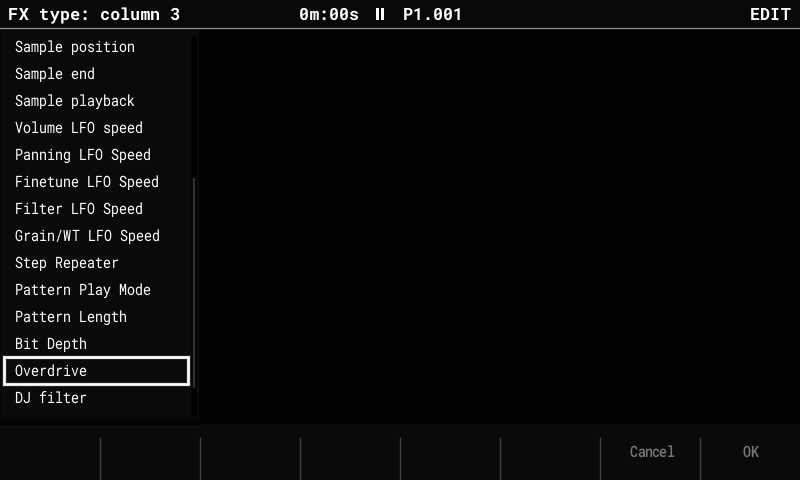
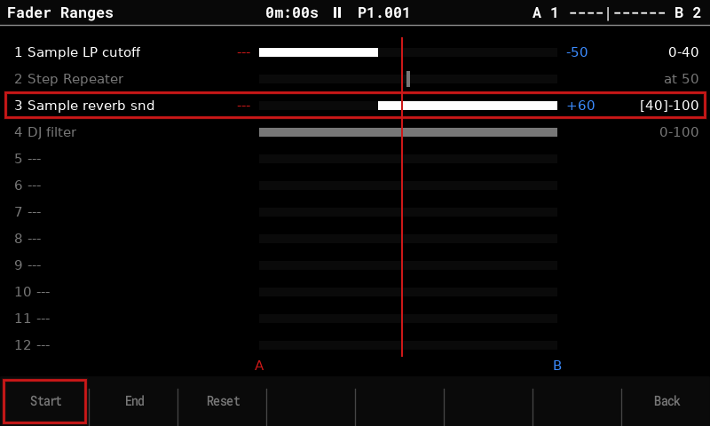
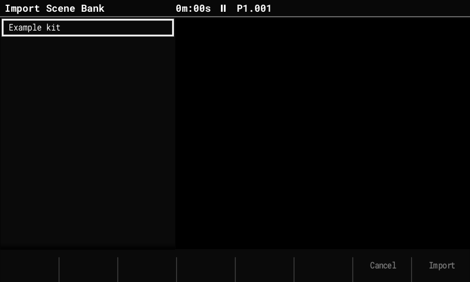
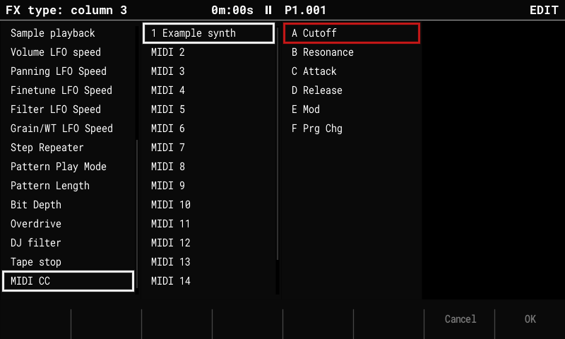

# Performance mode

The Performance screen plays effects live from the pads: 12 columns, each an effect type,
with 3 stored values per column on the pad rows. The fork adds **scenes with a
crossfader**, a **bank of 16 scenes**, **master FX** (DJ filter, tape stop) and **MIDI CC
columns** that play an external synth's parameters.


## Basics (as in stock)

- Press **Performance**. Hold a pad to play that column's value on its row; release to go
  back. The top row shows what's playing.
- **Rec** (edit mode): the encoder changes the value of the selected row. In the fork, a
  tapped row can be edited with the encoder without holding the pad.
- **Choosing a column's effect type** (fork): in edit mode, **Up / Down** open a list of
  every type on the column's current one, on the left of the screen (the title names the
  column). Move with the encoder (**Shift** + a quick turn for bigger jumps) or Up / Down,
  then press **OK (F8)**. **Cancel (F7)**, **Left / Right** or **Rec** close it without
  changing anything (for **MIDI CC**, Left / Right move between its lists instead). Nothing is applied until OK, and the F keys
  don't switch track effects while the list is open. The row values stay when the new
  type has the same range (e.g. Volume to Panning); otherwise they're cleared as in stock.
  Stock stepped the type with Up / Down, applying each one on the way.


- **The F keys** turn the effects on or off per track (lit = on). **Shift + F key** mutes
  the track. **Left / Right** (outside edit mode) switch the F keys between tracks 1–8 and
  9–16. In the fork the F keys are **remembered**: leaving the screen and coming back keeps
  them, and they're saved with the project (stock turns every track on again).

- Effect types include Volume, Panning, Tune, Low-pass / High-pass / Band-pass, Delay and
  Reverb send, Start / End pos, Direction, the LFOs, Repeater, Play mode, Length, Bit depth
  and Overdrive, plus the fork's **DJ filter**, **Tape stop** and **MIDI CC**.

## Scenes and the crossfader

A **scene** stores a row for every column. The crossfader's two ends, **A** and **B**,
each play a scene; the encoder (outside edit mode) or **MIDI CC 63** fades between them.

- Continuous values (volume, filters, sends …) fade smoothly. Filters cross over at the
  middle (a low-pass on A and a high-pass on B don't fight). Stepped effects (Repeater,
  Direction, Tape stop …) switch at the middle. With [fader ranges](#fader-ranges), each
  column can move over its own part of the fader instead.
- The title bar shows the pair (`A 1 |------| B 2`) and where the fader is. Rows of the
  scene on A are marked red, on B blue; the pad LEDs and the green (active) row follow
  the fader.
- A pad pressed on a column the scenes drive takes it over: its row plays and turns
  green. The next fader move hands the column back to the scenes.

### Store and clear while playing

| Keys | Does |
|---|---|
| **Shift + Left / Right** | Store the current pad rows into the scene on A / B. |
| **Delete + Left / Right** | Clear the scene on A / B. |
| Hold pads + **Shift / Delete + Left / Right** | Store / clear only the held columns. |

### Which tracks get the effects

Storing a **whole scene** (Shift + Left / Right with no pad held) also stores which tracks
have their effects on (the F keys). When that scene is loaded again, the F keys follow it:

- putting it on A or B (from the bank page or a song slot),
- moving the fader past the middle, to the scene on the other side.

So a song can have the drums in the Repeater in the verse and everything in the chorus.
A scene stored before (or cleared with Delete) carries no F keys and leaves them as they
are. Tapping an F key while a scene plays works as usual; the scene's setting comes back the
next time the scene is loaded or the fader crosses the middle. Storing only some columns
(pads held) doesn't change a scene's F keys. While a scene is open for editing (bank page,
**F3 Edit**), the F keys show and change that scene's tracks; going back saves them and
your live F keys come back.

## The scene bank

Press **Performance** again on the Performance screen to open the **scene bank page**:
16 scenes, with the ones on A and B marked.


| Key | Does |
|---|---|
| Arrows, encoder or pads | Select a scene. |
| **F1 Set A / F2 Set B** | Put the selected scene on the fader's A / B end. |
| **F3 Edit** | Open the scene on the Performance screen ("Editing scene N"): the pads set its rows, and you hear them as you go. Going back saves it. |
| **F4 Clear** | Clear the selected scene. |
| **F5 Export** | Save the columns and scenes as a bank file (see below). |
| **F6 Import** | Load a bank file into this project. |
| **F7 Ranges** | Set where on the fader each column moves (see below). |
| **F8 Back** or **Performance** | Back to playing. |
| **Play** | Start / stop, as when playing (here and on the Import and Ranges pages). |

Scenes can also be put on the fader by a song: see [Song mode](song-mode.md#scenes-per-slot).

## Fader ranges

By default every column moves across the whole fader: as you push from A to B, all of
them change together. A **fader range** gives a column its own part of the fader, so
one push can play a sequence of changes. For example, to build up:

| Column | Scene A | Scene B | Range |
|---|---|---|---|
| LP cutoff | -60 (closed) | 0 (open) | 0–33: opens first |
| Delay send | — | +60 | 33–66: then the delay comes in |
| Step Repeater | — | 1/16 | at 66: then the rolls start |

Scenes A and B stay the same; the range only sets *when* during the push each column
goes from its A value to its B value. Before its range a column holds A's value, after
it B's. Pulling the fader back undoes the changes in reverse. A song slot's
[ramp](song-mode.md#scenes-per-slot) moves the same fader, so it plays the sequence too.

Open the **Fader Ranges** page with **F7** on the bank page:



Each column has a row: its bar shows its range between **A** (left) and **B** (right),
and the red line is where the fader is now. Left of the bar is the value the column plays
at A (red), right of it the value at B (blue); `---` means that scene doesn't set the
column, so it has no effect there. Columns that neither scene on A / B drives are grey. A stepped column (Repeater, Direction, Tape stop …) can't move gradually, so
it has one **switch point** instead (`at 50` by default).

| Key | Does |
|---|---|
| Up / Down or a pad | Select a column. |
| **F1 Start / F2 End** | Toggle that edge on or off, like Rec. While one is on, its key is framed and the edge is in brackets (`[0]-100`). A stepped column's switch point moves with either. |
| Encoder | With Start or End on: move that edge. With neither: move the fader, to hear the result without leaving the page. |
| **F3 Reset** | The selected column back to the whole fader (0–100). |
| **F8 Back** | Back to the bank page. **Performance** goes back to playing. |

Ranges belong to the columns of the project and are saved with it and in exported bank
files.

## Scene bank files

A **scene bank** is a whole kit in one file, so it can move from song to song: the 12
columns (each one's effect type, its three row values and a MIDI CC column's target), the
16 scenes with their F keys, and which scenes are on A and B. Bank files are
`Performance/Scenes/<name>.txt` on the card.

- **F5 Export** opens the keyboard with a name (the bank imported last, else the
  project's name). **Save (F8)** writes the file, and asks before overwriting one.
- **F6 Import** lists the bank files. Move with the encoder or Up / Down, then press
  **Import (F8)**. Because importing **replaces this project's columns and scenes**, it
  asks first. **Cancel (F7)** or Left closes the list. The live pad rows start empty, and
  the fader blends the bank's scenes on A and B.



With **Performance presets** set to **Global** in Config (the default), the columns are
shared by every project, so importing a bank changes them everywhere, just as editing
a column does. The scenes always belong to the project.

### The bank file

Bank files are text, so they can be written or changed on a computer:

```
# OpenTracker scene bank
column 1 = Sample LP cutoff: -60 0 60
column 2 = Tape stop: 1 3 5
column 3 = MIDI CC: - 64 127 @ midi 2 slot A
column 4 = ---
scene 1 = 1 0 2 0 0 0 0 0 0 0 0 0
scene 2 fx off = 3 4 12
a = 1
b = 2
```

- `column N = type: row 1 row 2 row 3`. The type is written as it appears in the type list
  (any case), and `---` means an empty column. Values must be in the type's range; a value
  outside it reads as 0. A **MIDI CC** column holds CC values 0–127 (`-` = off) and its
  target, `@ midi 1-16 slot A-F`.
- `scene N = ...` lists twelve rows, one per column, from 0 to 3, where 0 means the scene
  doesn't drive that column. Scenes that aren't listed are empty.
- `scene N fx off = ...` lists the tracks whose F key the scene turns off (`none` turns them
  all on). Leave the line out and the scene doesn't change the F keys.
- `a` and `b` give the scenes on A and B.
- `range N = start end` gives column N's [fader range](#fader-ranges) (0–100). Leave it
  out for the whole fader; a stepped column's switch point is written as `range N = 66 66`.
- `#` starts a comment. Unknown lines are ignored.

## Master FX

Two effect types act on the **whole mix** (after all tracks and synths, before the
limiter), instead of on each track:

- **DJ filter:** one value from −100 to +100. Below 0 a low-pass sweeping down, above 0 a
  high-pass sweeping up, 0 off. It's smoothed, so pads and the fader don't click, and it
  uses no CPU while off.
- **Tape stop:** momentary. Hold its pad and the mix slows down to a stop over **1 or 2
  steps, beats or bars** (the row's value); release and it spins back up. It borrows
  free sample memory while it runs (shared with resampling), so it can refuse when
  memory is full.

Set them like any column: in edit mode, **Up / Down** open the type list; **DJ filter**
and **Tape stop** are at the end.

## MIDI CC columns

A **MIDI CC** column plays a parameter of an external synth: one of a MIDI instrument's
CC slots A–F, on that instrument's channel. Set it up in the type list: highlight
**MIDI CC**, press **Right** to pick the MIDI instrument (shown with its
[preset](midi-presets.md) name), **Right** again to pick the slot (shown with its CC name),
then **OK (F8)**.



- The column is labelled with the instrument and the CC's name, e.g. **MIDI 3 Cutoff**.
  Which CC a slot sends is set on the MIDI instrument's parameters page, so change it
  there and the column follows.
- Rows hold a value 0–127 (an empty row, `---`, is off). A pad press sends its value;
  the fader, scenes and incoming CC send only when the value changes. Off, or leaving
  the screen, sends nothing, so the synth keeps its last value.
- Several MIDI CC columns play at once, one per parameter. Two columns on the same slot
  are like two columns of one type: pressing one turns the other off.
- **Scenes** fade each MIDI CC column on its own, so the fader (or a song's slot ramp)
  sweeps a synth's filter as it does a sample filter. A scene that doesn't drive the
  column leaves it at the other scene's value: a CC has no "off" value to fade to.
- If the instrument's [MIDI LFO](midi-lfo.md) is on the same slot, the column sets the
  LFO's **Center**, as a CC step FX does, and the LFO keeps swinging around it.

## Saved with the project

The scene bank, the F keys (live and per scene), the master FX and MIDI CC types, the
MIDI CC columns' instruments and slots and the fader ranges are stored in
`perf_scenes.bin` next to `project.mt`. Stock firmware and the Tracker Mini see those columns as empty and ignore
the scenes.
