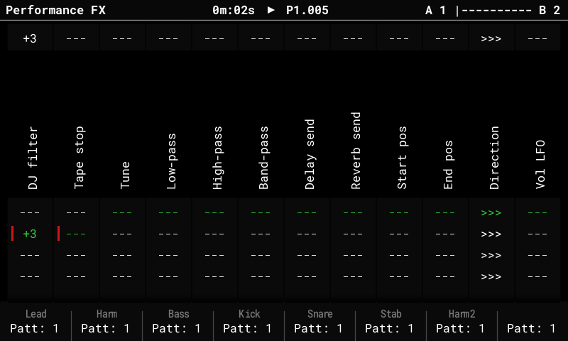
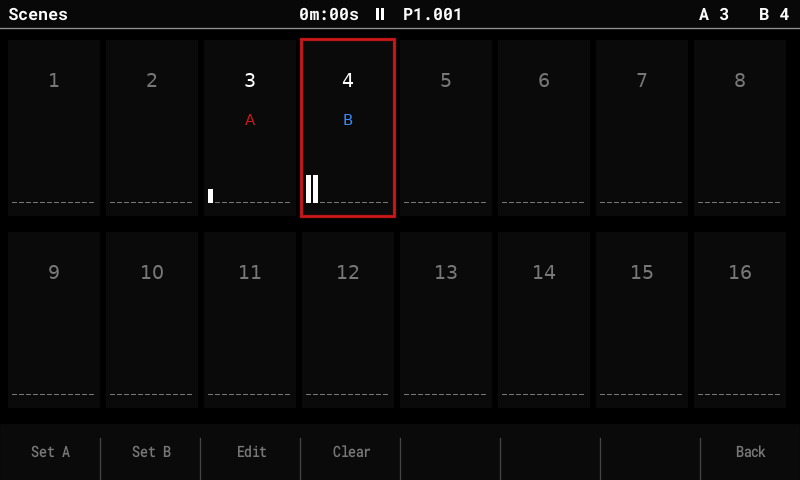

# Performance mode

The Performance screen plays effects live from the pads: 12 columns, each an effect type,
with 3 stored values per column on the pad rows. The fork adds **scenes with a
crossfader**, a **bank of 16 scenes**, and **master FX** (DJ filter, tape stop).

## Basics (as in stock)

- Press **Performance**. Hold a pad to play that column's value on its row; release to go
  back. The top row shows what's playing.
- **Rec** (edit mode): **Up / Down** change a column's effect type, the encoder changes
  the value of the selected row. In the fork, a tapped row can be edited with the encoder
  without holding the pad.
- **The F keys** turn the effects on or off per track (lit = on). **Shift + F key** mutes
  the track. **Left / Right** (outside edit mode) switch the F keys between tracks 1–8 and
  9–16.
- Effect types include Volume, Panning, Tune, Low-pass / High-pass / Band-pass, Delay and
  Reverb send, Start / End pos, Direction, the LFOs, Repeater, Play mode, Length, Bit depth
  and Overdrive, plus the fork's **DJ filter** and **Tape stop**.

## Scenes and the crossfader

A **scene** stores a row for every column. The crossfader's two ends, **A** and **B**,
each play a scene; the encoder (outside edit mode) or **MIDI CC 63** fades between them.

- Continuous values (volume, filters, sends …) fade smoothly. Filters cross over at the
  middle (a low-pass on A and a high-pass on B don't fight). Stepped effects (Repeater,
  Direction, Tape stop …) switch at the middle.
- The title bar shows the pair (`A 1 |------| B 2`) and where the fader is. Rows of the
  scene on A are marked red, on B blue; the pad LEDs follow the fader.

### Store and clear while playing

| Keys | Does |
|---|---|
| **Shift + Left / Right** | Store the current pad rows into the scene on A / B. |
| **Delete + Left / Right** | Clear the scene on A / B. |
| Hold pads + **Shift / Delete + Left / Right** | Store / clear only the held columns. |

## The scene bank

Press **Performance** again on the Performance screen to open the **scene bank page**:
16 scenes, with the ones on A and B marked.

| Key | Does |
|---|---|
| Arrows, encoder or pads | Select a scene. |
| **F1 Set A / F2 Set B** | Put the selected scene on the fader's A / B end. |
| **F3 Edit** | Open the scene on the Performance screen ("Editing scene N"): the pads set its rows, and you hear them as you go. Going back saves it. |
| **F4 Clear** | Clear the selected scene. |
| **F8 Back** or **Performance** | Back to playing. |

Scenes can also be put on the fader by a song: see [Song mode](song-mode.md#scenes-per-slot).

## Master FX

Two effect types act on the **whole mix** (after all tracks and synths, before the
limiter), instead of on each track:

- **DJ filter:** one value from −100 to +100. Below 0 a low-pass sweeping down, above 0 a
  high-pass sweeping up, 0 off. It's smoothed, so pads and the fader don't click, and it
  uses no CPU while off.
- **Tape stop:** momentary. Hold its pad and the mix slows down to a stop over **1 or 2
  steps, beats or bars** (the row's value); release and it spins back up. It borrows
  free sample memory while it runs (shared with resampling), so it can refuse when
  memory is full.

Set them like any column: in edit mode, **Down** on a column cycles its type through to
**DJ filter** and **Tape stop**.

## Saved with the project

The scene bank and the master FX types are stored in `perf_scenes.bin` next to
`project.mt`. Stock firmware and the Tracker Mini see those columns as empty and ignore
the scenes.
