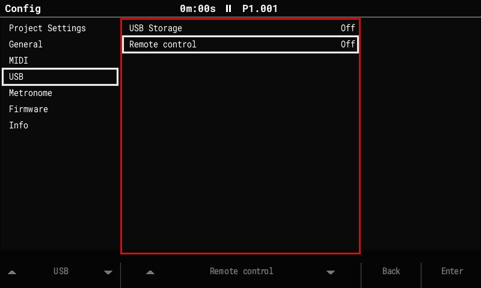

# Remote control

A Tracker running OpenTracker can be connected to a computer over USB and driven from it:
as the simulator's front panel, by test scripts, or mirrored live on screen.



## Turn it on

1. Connect the Tracker by USB.
2. **Config > USB > Remote control: On.** It's Off again after every power-on.
3. On Linux the Tracker appears as a serial port, usually `/dev/ttyACM0`. If it can't be
   opened, add your user to the group that owns it (`uucp` on Arch, `dialout` on
   Debian/Ubuntu).

!!! note "One program at a time"
    The link shares the USB serial port with the diag log. Close serial terminals,
    loggers or anything else that holds the port open first.

A short press of the power switch ends remote control (holding it still powers off).

## Three ways to use it

### Drive mode: scripts

`tools/tracker_remote.py` presses buttons and pads, turns the encoder, reads the
Tracker's status (screen, transport, output level, CPU, the current notice), the text on
screen, and takes screenshots. The Tracker's own controls keep working.

```sh
tools/tracker_remote.py /dev/ttyACM0 -c "tap PERFORMANCE; wait 300; expect-screen Performance; text; screenshot perf.png" \
    --out shots --log tracker.log
```

- Scripts use the [simulator's script language](../dev/simulator.md#scripts) plus
  checks (`expect-text`, `expect-sound`, `wait-for slot == 2` …). Ready-made ones are
  in `tools/remote_scripts/`; the same files run on the simulator in CI.
- `--log` keeps everything the Tracker sends, including its telemetry lines. Check them
  with `tools/telemetry_check.py log tracker.log`.

!!! warning "Edit mode"
    In the Pattern screen's edit mode, the encoder and pads **change the pattern**. Turn
    edit mode off before running scripts that use them there.

### Live mirror

The simulator shows the Tracker's screen live and sends its window's keys and mouse to
the Tracker:

```sh
build/sim/opentracker-sim --mirror /dev/ttyACM0
```

The Tracker sends each frame it draws (about 12 per second while playing).

### Panel mode

The Tracker becomes the simulator's front panel: its buttons, pads and encoder drive the
simulator, and the simulator lights its pads.

```sh
build/sim/opentracker-sim --remote /dev/ttyACM0
```

The Tracker shows "Remote control: panel drives the simulator" and stops reacting to its
own controls until the simulator quits or the cable is unplugged (it recovers within 2 s).
