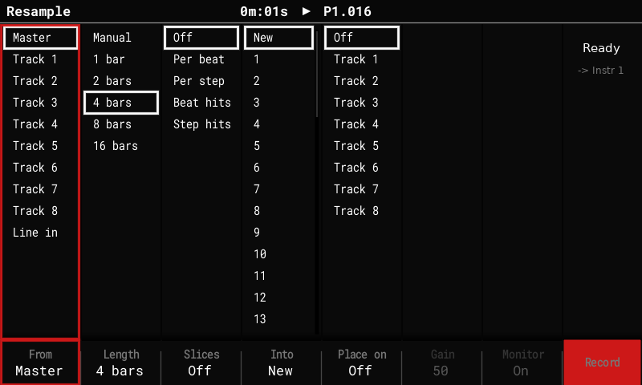

# Live resampling

Record **the master mix, one track (including the synth it plays) or Line in** while the
sequencer keeps playing, Octatrack-style. The take starts on the next bar and lasts 1, 2,
4, 8 or 16 bars, or until you stop it. It lands in an instrument slot, ready to play,
slice or re-record.

## Open the Resample screen

- **While playing**, press **Sample Recorder**. The Tracker asks "This will stop the
  pattern"; press **Resample** (F6) instead. The pattern keeps playing.
- **Shift + Sample Recorder** arms, stops or cancels a take from **any screen**, with the
  Resample screen's current settings.

## Settings

| Column (key) | Choices |
|---|---|
| **From** (F1) | **Master** (after the limiter; what the computer records over [USB audio](usb-audio.md), without the USB input), **Track 1–8** (the track's sample voice plus the synth notes it plays, dry), **Line in** (with the recorder's channel mode), **USB** (what the computer plays into the Tracker, [USB audio](usb-audio.md)). |
| **Length** (F2) | **Manual** (until you stop it, snapped to a bar) or 1, 2, 4, 8, 16 bars. |
| **Slices** (F3) | **Off**, **Per beat**, **Per step** (equal slices), **Beat hits**, **Step hits** (a slice only where a new hit starts, so empty steps stay empty). |
| **Into** (F4) | **New** (the next free instrument) or **instrument 1–48** (re-record into it). |
| **Place on** (F5) | **Off** or **Track 1–8**: write the take onto a track. |
| **Gain**, **Monitor** (F6, F7) | Line in only: the recorder's input gain and monitoring. |
| **Record** (F8) | Arm: the take starts on the next bar (or with Play). Press again to stop at the next bar. |

The right-hand column shows the take's state (Ready, Armed, Recording …) and, for Line
in, a level meter.

## Where the take goes

- **Into: New** puts the take into the next free instrument above every loaded one, in
  stereo, so no playing sample moves. It's saved with the project.
- **Into: Instrument N** re-records into N:
    - a take of the **same length** overwrites N in place, without a gap, and keeps N's
      settings, so a loop can be re-sampled take after take while it plays;
    - a take of **another length** isn't lost: it's saved as a new instrument, and a
      notice says so.
    - Arming into a slot that holds a sample asks once.
- The take records into the free sample memory, which is reserved while it runs. The
  Sample Loader's memory bar counts it, and loading a sample during a take says why it
  can't.

## Slices and Place on

- With **Slices** on, the take becomes a **Beat Slice** instrument: note 24 + i (pad
  i + 1) plays slice i. At most 48 slices; the grid doubles until they fit.
- **Place on track N** writes the take onto the track's first step, repeating every take
  length, or, when sliced, each slice on its own step, so the Performance FX (Repeater,
  Play mode, Direction, Start pos) work on it in time. Place on can be undone.

## Tips

- Resampling a track records it **dry**: no delay or reverb sends, no master FX.
- The diag log on USB gets one line per take (frames, silent blocks, peak, input health),
  useful when a Line in take has dropouts.
