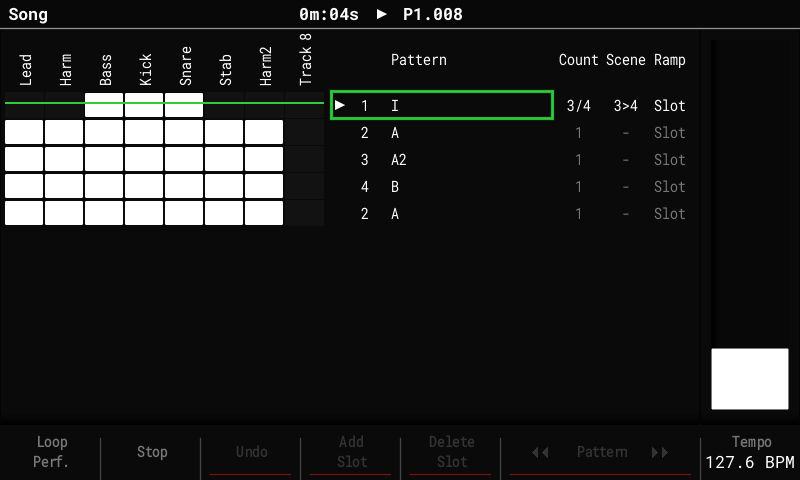
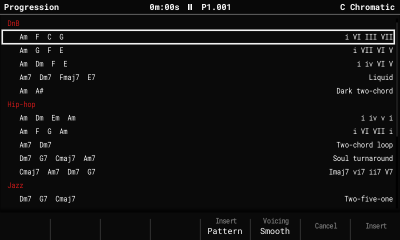
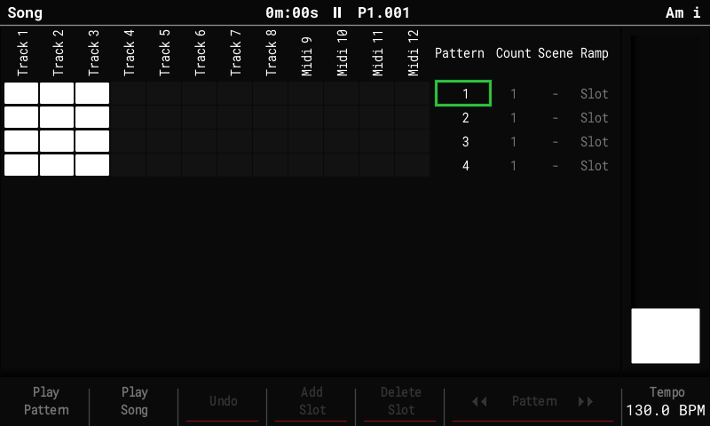

# Song mode

The Song screen arranges patterns into a list of slots. The fork adds **repeat counts**,
a **Performance scene per slot**, and **fader ramps** between two scenes, so a song can be
arranged with performance changes without copying patterns, and **progressions**: chord
patterns added in the order of a chord progression.



The track grid shows 8 tracks at a time: tracks 1-8 (the sample tracks), and tracks 9-16
(the MIDI tracks) once the grid cursor moves past track 8. The space this frees shows each
pattern's name next to its number, as on stock.

The Song list has four columns: **Pattern**, **Count**, **Scene** and **Ramp**. In edit
mode (**Rec**), **Right** moves from the list into the columns, **Left** back. **Delete**
resets the selected value.

## Repeat counts

- **Count** plays the slot's pattern **1 to 16 times** before the song moves on, so a
  section no longer needs duplicate slots. Set it with the encoder.
- While playing, the playing slot shows its pass, for example `3/4`.
- **Add Slot** copies the count. Loop Pattern / Continue Song work as before (Continue
  leaves the slot at the end of the current pass).

## Scenes per slot

- **Scene** puts a scene from the [scene bank](performance.md#the-scene-bank) on the
  crossfader's **A** end as the slot starts, with the fader at A. The encoder picks the
  scene, or `-` for none.
- **Shift + encoder** adds a second scene for **B** (shown as `3>4`).
- A slot's scene plays on **any screen**, not only on the Performance screen, until Stop
  or the next slot.
- A `-` slot (no scene): on the Performance screen what plays stays; on other screens the
  song's scene ends (FX off). To hold a scene across slots, set it on each slot.

## Ramps

A slot with a scene on B sweeps the fader from A to B. **Ramp** sets when:

| Ramp | The fader goes A → B … |
|---|---|
| `Slot` | across all the slot's passes |
| `Each` | across each pass, back to A as the next one starts |
| `First` | across the first pass, then stays on B |
| `Last`, `L2` … `L15` | across the last N passes (the choices follow the slot's Count) |
| `1` … `128` | across the slot's last N steps (Shift + encoder moves by 16) |

Moving the fader yourself takes over until the next slot.

## Moving around

- **Song + Right** jumps from the track grid straight to the Pattern list; **Song + Left**
  goes back into the grid (edit mode). **Shift + Left / Right** still sizes the grid
  selection.

## Progressions

A common way to write chords on the Tracker is one chord per pattern, each pattern named
after its chord, with Song mode putting them in order. **Insert** (in edit mode) does that
for you: pick a progression and it adds the slots, with a named pattern for each chord.

For example, in A minor (Config > Project Settings: Root note A, Scale Minor), press
**Rec**, then **Insert**, pick `Am  F  C  G   i VI III VII` and press **F8 Insert**. Four
slots appear after the cursor, playing four patterns named `Am i`, `F VI`, `C III` and
`G VII`, each with its chord on step 1 of tracks 1-3, using the current instrument. Press
**F2 Play Song** to hear it, then open each pattern to give the chord a rhythm, add drums,
or change the voicing.





- The Pattern list shows each pattern's name, so the song reads as its chords.
- The list shows each progression's chords in the project key, with its numbers (or its
  title) on the right, under a heading per file. **Up / Down** or the encoder pick one,
  **F8** or **Insert** adds it, **F7** or **Left** closes the list.
- A chord that already has a pattern named after it reuses that pattern (only the name's
  first word is checked, so a pattern you called `F` counts as F). A chord that comes twice
  in a progression gets one pattern.
- New chords go into empty, unnamed patterns that aren't in the song yet. Nothing you made
  is overwritten. If the cursor slot holds an empty, unnamed pattern (a new project's
  slot 1), the progression starts there instead of after it.
- New patterns take the track lengths of the cursor slot's pattern. Sevenths use tracks 1-4.
- The numbers are worked out from the key when you add the progression. Changing the key
  later leaves the pattern names as they are.

### The progression files

The list comes from text files in `Progressions/` on the card, one heading per file
(`Jazz.txt` shows as Jazz). The first time you open the list with no files there, the
Tracker writes its own: DnB, Hip-hop, Jazz and Pop. Edit them, add your own, or copy
them to share; a file of yours is never overwritten. To get the built-in files back,
delete or rename them.

Each line is one progression, written as numbers so the same file works in any key:

```
# Jazz.txt
ii7 V7 Imaj7 | Two-five-one
iim7b5 V7 i
i VI III VII | Jungle pads
```

- **I** to **VII** are the chords on the 1st to 7th note of the key. Upper case is a major
  chord, lower case a minor one.
- After the number: `7` (a 7th: dominant on upper case, minor on lower), `maj7`, `m7`,
  `dim`, `dim7`, `m7b5`, `aug`, `sus2`, `sus4`.
- `b` or `#` in front lowers or raises the chord's root a semitone (`bVII` in C is Bb).
- Chords are built as written, even when that takes a note from outside the key: `V` in
  a minor key is a major chord (E in A minor), as it usually is in minor.
- **Major or minor:** start a line with `major:` or `minor:` to say which key it is in
  (`minor: iv V`). Without it, the Tracker picks the key whose own chords the line uses
  most: `iv V` and `iv VII III VI` are minor (Dm E and Dm G C F in A minor), `I V vi IV`
  is major. In a minor key the numbers count on the natural minor scale (`VI` in A minor
  is F), and `viidim` / `viidim7` sit on the raised 7th, as in harmonic minor (G#dim in
  A minor).
- **In the project key:** a scale with a minor 3rd and no major 3rd counts as minor (Minor, Dorian,
  Phrygian, Locrian, Harm Min, ...), any other as major (Major, Lydian, Mixolydian,
  Chromatic, ...). A progression of the same kind plays on the project's root note; one
  of the other kind plays in the relative key. In A minor, `I V vi IV` gives C G Am F.
- **Modes** play progressions as their parallel major or minor key. D Dorian counts as
  D minor: `i IV` gives Dm G and `I V vi IV` gives F C Dm Bb. Chords that use the note
  where the mode differs from plain minor or major leave the mode's scale (the Bb above;
  Dorian has B).
- **Names:** with **Note names** on Auto (Config > General) chords are spelled from the
  key: each number has its own letter, so `bVII` in C is Bb and `vii` dim in F# major is
  E#dim, not Fdim. With Sharps or Flats, every chord name follows that setting (`bVII` in C
  shows as A# with Sharps); the notes always sound the same.
- The numbers in a pattern's name are the progression's, as written: in A minor,
  `I V vi IV` names its first pattern `C I`.
- Text after `|` is the title shown in the list. Lines starting with `#` are comments.
  Lines that can't be read are skipped; the list says how many.

## Saved with the project

Counts, scenes and ramps are stored in `song.bin` next to `project.mt`. Stock firmware
plays every slot once, without scenes.

## Exporting

**File > Export > Song** and **Song Stems** render the slots' scenes and ramps the way
playback does. **F7 Perf FX** on the Export page turns this **On / Off** (On after every
power-on); Off gives the stock export without Performance FX.

- Stems get each track's Performance FX. The master FX (DJ filter, tape stop) act on the
  whole mix, so only the full-mix export (**Song**) has them.
- Only what the song stores is rendered: where the fader or the pads were when you pressed
  Export doesn't matter, so the same song always exports the same way.
- Pattern exports play no song slots, so they render without scenes.
