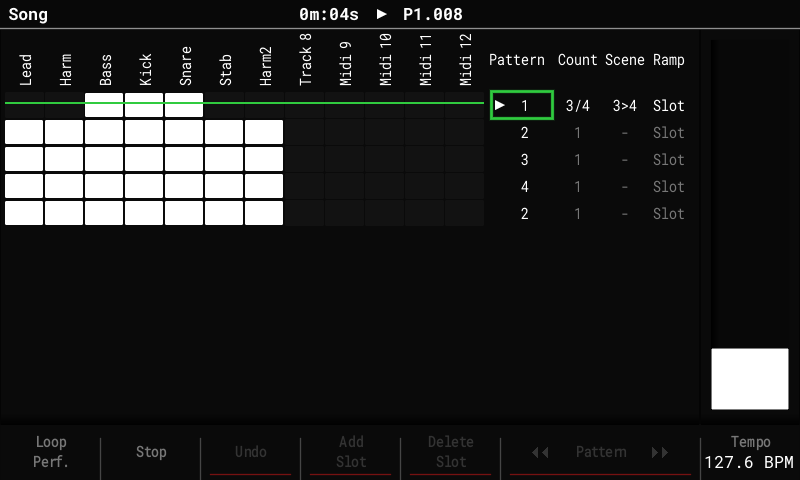

# Song mode

The Song screen arranges patterns into a list of slots. The fork adds **repeat counts**,
a **Performance scene per slot**, and **fader ramps** between two scenes, so a song can be
arranged with performance changes without copying patterns.

The Song list has four columns: **Pattern**, **Count**, **Scene** and **Ramp**. In edit
mode (**Rec**), **Right** moves from the list into the columns, **Left** back. **Delete**
resets the selected value.

## Repeat counts

- **Count** plays the slot's pattern **1 to 16 times** before the song moves on, so a
  section no longer needs duplicate slots. Set it with the encoder.
- While playing, the playing slot shows its pass, for example `3/4`.
- **Add Slot** copies the count. Loop Pattern / Continue Song work as before (Continue
  leaves the slot at the end of the current pass).

## Scenes per slot

- **Scene** puts a scene from the [scene bank](performance.md#the-scene-bank) on the
  crossfader's **A** end as the slot starts, with the fader at A. The encoder picks the
  scene; `-` keeps whatever plays.
- **Shift + encoder** adds a second scene for **B** (shown as `3>4`).
- A slot's scene plays on **any screen**, not only on the Performance screen. It stops at
  Stop, or when the song reaches a `-` slot (on the Performance screen, a `-` slot keeps
  what plays).

## Ramps

A slot with a scene on B sweeps the fader from A to B. **Ramp** sets when:

| Ramp | The fader goes A → B … |
|---|---|
| `Slot` | across all the slot's passes |
| `Each` | across each pass, back to A as the next one starts |
| `First` | across the first pass, then stays on B |
| `Last`, `L2` … `L15` | across the last N passes (the choices follow the slot's Count) |
| `1` … `128` | across the slot's last N steps (Shift + encoder moves by 16) |

Moving the fader yourself takes over until the next slot.

## Moving around

- **Song + Right** jumps from the track grid straight to the Pattern list; **Song + Left**
  goes back into the grid (edit mode). **Shift + Left / Right** still sizes the grid
  selection.

## Saved with the project

Counts, scenes and ramps are stored in `song.bin` next to `project.mt`. Stock firmware
plays every slot once, without scenes.

## Exporting

**File > Export > Song** and **Song Stems** render the slots' scenes and ramps the way
playback does. **F7 Perf FX** on the Export page turns this **On / Off** (On after every
power-on); Off gives the stock export without Performance FX.

- Stems get each track's Performance FX. The master FX (DJ filter, tape stop) act on the
  whole mix, so only the full-mix export (**Song**) has them.
- Only what the song stores is rendered: where the fader or the pads were when you pressed
  Export doesn't matter, so the same song always exports the same way.
- Pattern exports play no song slots, so they render without scenes.
