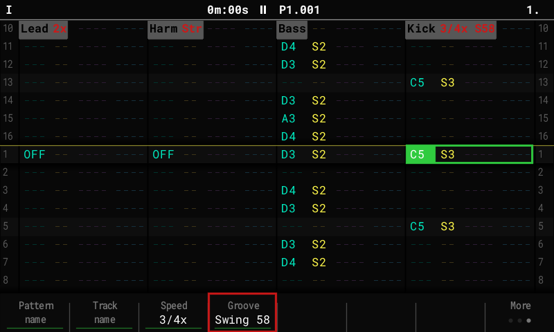

# Track timing

Give each track of a pattern its own **speed** and **groove**. For example: hats at
**2x** over a kick at 1x, a bass at **1/2x** that takes two loops of the pattern to play
its 16 steps, drums on **Swing 58** while the keys stay **Straight**.

## Setting it

On the Pattern screen, press **More** (F8) twice for the names page:

| Key | Does |
|---|---|
| **Speed** (F3) | Hold and turn the encoder (or Up / Down): 1/8x, 1/4x, 1/2x, 3/4x, **1x**, 1.5x, 2x. |
| **Groove** (F4) | Hold and turn: **Global**, Straight, Swing 54, 58, 62, 66, 71, Shuffle, Laid back. |

- They set the **cursor track** of the **current pattern**. While holding F3 or F4,
  Left / Right moves to the next track, so you can set several in one go.
- A track off the defaults shows a tag in its header: `Hats 2x`, `Kick 3/4x S58`,
  `Keys Str`. A pattern with every track at 1x / Global looks as on stock.
- Undo takes a change back. Copying a pattern copies its timing.

## Speed

- Speed changes **when steps play**, never how they sound: a sample keeps its pitch and
  length, so at 2x a long sample is cut by the next note on the track.
- Things counted in steps follow the track: Roll, Arp, Micro-move, Gate and the groove.
  Things counted in time don't: envelopes, LFOs, Timestretch.
- The **pattern** still ends after its length at 1x, and song mode moves on then. A track
  at another speed wraps on its own length: at 2x it loops twice per pattern, at 1/2x
  it plays half its steps per pattern and carries on from there the next time round.
  Switching to another pattern starts every track from step 1 again.
- MIDI clock out, the metronome and the playhead row follow the pattern at 1x.

## Groove

- **Global** (default): the track swings with the **Swing** step FX, as on stock.
- Any other groove **replaces** the Swing FX for that track: **Straight** keeps it even
  while the rest swings; **Swing 54–71** delays every second step by that much (MPC
  style: 54 is a light lilt, 66 close to triplets); **Shuffle** swings 8th notes;
  **Laid back** plays beats 2 and 4 a little late.
- A groove moves notes by where they sit in the bar, so notes you add later get it too.
  Micro-move still nudges a single note on top.

## Compatibility

The settings are saved in `timing.bin` next to `project.mt`, only while a pattern uses
them. Stock firmware and the Tracker Mini ignore the file and play every track at 1x with
the Swing FX.
