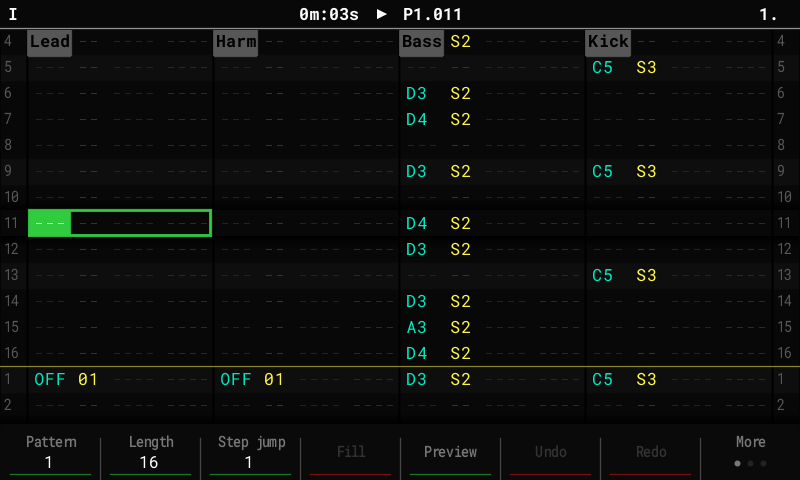

# OpenTracker (syamajala fork)

OpenTracker is an open-source, clean-room firmware for the **original Polyend Tracker**,
written from behavioural specifications. It contains no Polyend code, fonts, icons or
graphics, and is not affiliated with or endorsed by Polyend.

This fork follows [upstream OpenTracker](https://github.com/sandlbn/polyend-tracker-re)'s
2.x line (currently **2.2.3**) and adds features on top. Projects stay compatible: the
fork's additions are stored in extra files next to `project.mt`, so stock firmware,
upstream OpenTracker and the Tracker Mini still open them.

!!! note "These are the docs for `main`"
    The site shows the documentation of the development branch. Once the fork makes
    releases, a version picker at the top selects the docs that match your image.

## What this fork adds

| Feature | In short |
|---|---|
| [DX7 synth](guide/dx7.md) | A 6-operator FM engine that plays Yamaha DX7 voices from `.syx` banks. |
| [Live resampling](guide/resampling.md) | Record the master, one track or Line in while the pattern keeps playing; slice the take and place it on a track. |
| [Performance mode](guide/performance.md) | 16 scenes with a crossfader, scene banks you can export and import, master FX (DJ filter, tape stop) and MIDI CC columns that play an external synth. |
| [Song mode](guide/song-mode.md) | Repeat counts, a Performance scene per song slot, and fader ramps between scenes. |
| [Multisample instruments](guide/multisample.md) | Load an `.sfz` as one instrument that plays the nearest sampled note across the keys. |
| [USB audio](guide/usb-audio.md) | The Tracker as a USB sound card: play and sample the computer's audio, record the Tracker on the computer. |
| [MIDI instrument LFO](guide/midi-lfo.md) | A tempo-locked LFO per MIDI instrument: CC, pitch bend or pressure. |
| [MIDI presets](guide/midi-presets.md) | Save a synth's MIDI setup (CC slots with names, LFO) and load it into any MIDI instrument; presets for several synths included. |
| [More](guide/more.md) | Slices to pattern, chord entry, piano pads, note names (sharps / flats / auto), plus a summary of the 2.x features from upstream. |
| [Remote control](guide/remote-control.md) | Drive a Tracker from a computer: scripts, screen text, a live mirror. |

## Where to start

- **Installing**, and getting back to stock firmware: [Install and go back](install.md).
- **Something went wrong**: [Troubleshooting](guide/troubleshooting.md).
- **Building, testing or contributing**: the [Developers](dev/building.md) section.

## Known limitations

- The synth engines are our own design: their settings follow the Tracker Mini, and the
  sound is close but not identical.
- Wavetable and granular samples play the left channel only.
- Synth notes ignore the per-track Performance columns
  ([#30](https://github.com/syamajala/polyend-tracker-re/issues/30)); the master FX do
  include them.
- The synth voice pool defaults to 4 voices because of the processor's speed.
- USB audio works with Linux and Windows computers, not macOS.
- USB Storage mode: back up the card before first use.
- The USB ID is the pid.codes test ID 1209:0001.

Screenshots in these docs come from the desktop simulator, which runs the same code as the
firmware.
